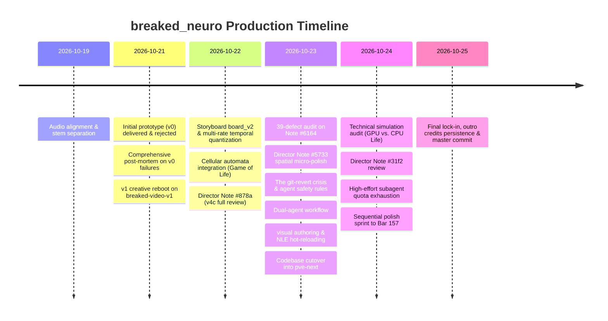
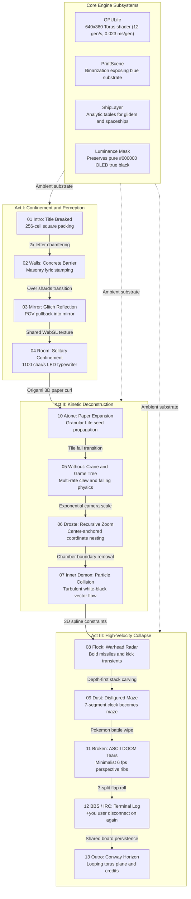

# Engineering Generative Music Videos: A Post-Mortem on Human-AI Creative Direction, Systems Architecture, and Collaborative Dynamics

This paper records the production history, creative evolution, engineering hardships, and collaboration dynamics during the development of the code-rendered music video for `breaked_neuro`. It serves as a definitive case study and reference guide for procedural video production using autonomous coding agents.

---

## 1. Executive Summary & Song Specifications

- **Track**: `breaked_neuro` (200 BPM Neurofunk Drum & Bass).
- **Tempo**: 200 BPM ($1\text{ bar} = 1.200\text{ s}$, $1\text{ beat} = 0.300\text{ s}$).
- **First Downbeat**: 0.296 s.
- **Duration**: 194.261 seconds (162 bars, 5,828 frames at 30 fps).
- **Aspect Ratio**: 2.39:1 cinematic letterbox (rendered inside a 1920x1080 canvas with active viewport `1920x803`, letterbox bars of 138.5 px top and bottom).
- **Technology Stack**: WebGL fragment shaders, HTML5 Canvas 2D, WebCodecs GPU encoding, SolidJS NLE studio, and TypeScript scene graphs.
- **Objective**: Match and surpass human-authored procedural animation benchmarks (`pdoom_original`) using pure code, kinetic typography, and cellular automata.

### Core Finding
When given high-level prompts, autonomous generative agents default to literal interpretations, smooth continuous motion, decorative UI cliches, and generic sci-fi tropes. Achieving production-grade artistic output requires a strict division of labor:
1. **The Human Director** acts as the conceptual visionary, emotional compass, and ruthless editor. The director injects non-linear metaphors, structural constraints, and discrete temporal rhythms.
2. **The Autonomous Agent** acts as the mathematical and graphical formalizer. The agent implements complex matrix transformations, custom WebGL shaders, discrete automata lattices, and audio envelope synchronization.

---

## 2. Chronological Timeline of Co-Creation

The production spanned four core sessions across two repository worktrees (`probable-video-editor` and `pve-next`):



| Session ID | Environment | Dates | Prompts | Primary Milestone |
|---|---|---|---|---|
| `01a129c9-3916` | `probable-video-editor` | Oct 19–21, 2026 | 3 (fork root) | Stem ingestion, initial `v0` delivery, and `v0` post-mortem |
| `01a15efc-6de7` | `probable-video-editor` | Oct 21–23, 2026 | 183 | Ground-up `v1` authoring, scene graph, Director Notes #878a, #6164, #5733 |
| `01a1689a-f407` | `pve-next` | Oct 23–25, 2026 | 256 | NLE hot-reload development, `pve-next` migration, Note #31f2, final polish |
| `01a16c65-37b2` | `pve-next` | Oct 24, 2026 | 3 | Simulation audit: GPU shader torus vs. CPU bitboards |

---

## 3. The v0 Prototype Failure: The Karaoke Trap

On October 21, the assistant delivered the first end-to-end procedural render of `breaked_neuro`. The pipeline compiled, unit tests passed, and an MP4 video file was generated across eleven plates.

### The Director Critique
The director rejected the render immediately. The critique was direct and uncompromising:

> *"The entire video is a failure. It is the most bland visual result possible. It does not achieve 1% of pdoom_original. Basically everything done in v0 should be avoided."*
>
> *"Additionally, lyrics.calibrated.json provided syllable-level timing that was not used at all. Overall, it is not about the math. The visuals and the actual song do not match at all. I could not feel any emotion. You created a glorified karaoke background, which is not what we wanted. Lyrics word progress should not be overused. You are supposed to be creative, not build a karaoke stage background."*

### Root Causes of the Initial Failure
The post-mortem in `.lessons/breaked_neuro_v0.md` identified five core failure modes:

1. **The Karaoke Trap**: The assistant defaulted to displaying static horizontal sentences and wiping highlight colors across syllables from left to right. This passive subtitle prompter destroyed the kinetic energy of a 200 BPM neurofunk track.
2. **Ignoring Syllable-Level Micro-Timing**: High-precision phonetic alignment data (`lyrics.calibrated.json`) was available, but the rendering code bucketed text into coarse line-level intervals.
3. **Absence of Scene Identity**: Every section used identical fonts, centered layouts, and uniform camera perspectives.
4. **Mismatched Energy**: Visual pacing did not reflect the complex drum breaks, aggressive bass drops, or syncopated rhythms.
5. **Silent Black Renders**: Mathematical `NaN` values entered the `PostOverrides` shader uniforms during camera transitions. The fragment shader failed to clamp inputs, causing the entire frame buffer to output pure black while reporting successful PNG encoding.

### The Strategic Decision
Treat `v0` as a complete conceptual write-off. Salvage the underlying mathematical utilities, audio loaders, and export plumbing into branch `next`, then reboot `v1` from a clean slate.

---

## 4. Creative Reboot: The Socratic "Grill Session"

To prevent another cycle of generic generative assumptions, the director prohibited immediate code generation:

> *"v0 was very underwhelming. I want to be truly surprised by an epic music video. Then grill me with questions."*

This command initiated the **Grill Session**:
- The AI was forbidden from writing code until it interrogated the director's visual treatment.
- The AI questioned layout density, camera speeds, typographic hierarchy, and visual metaphors.
- Ambiguities in the script had to be resolved on paper before touching scene files.

### Key Conceptual Pivots

#### 1. Multi-Rate Temporal Quantization
Procedural graphics often feel floaty and sterile when rendered at a continuous 60 fps. The director instructed:
> *"General direction: make it lower framerate. 60 fps does not fit this genre at all. Globally render at 30 fps, but layers can have different framerates that are lower, like 15 or 24 fps. That is a magic trick."*

Layers were given independent update frequencies: typography updated at 24 fps, Conway cellular automata at 15 fps, and particle debris at 12 fps. This temporal layering created a crunchy, deliberate, anime-style motion graphics cadence.

#### 2. Grounding via Reference Video Deconstruction
Instead of hallucinating reference styles from language model weights, the assistant extracted frames from local reference videos (`Max Cooper - Aleph 2`, `Shun Yamaguchi - Nhelv`, `Rainshower`) into contact sheets. This disproved the assistant's initial assumption that *Nhelv* was a futuristic 3D HUD. The contact sheets revealed it was an organic, ink-stained, binarized print composition with torn paper edges and hairline vector splines.

#### 3. Blue as the Substrate
During review, the director introduced a fundamental aesthetic inversion:
> *"The blue is a background that is always there. The items on top of it are what is being thresholded and binarized."*

This inverted the shader pipeline. Blue (`#2a1fff`) was not drawn as an ink, stroke, or foreground object. Blue became the metaphysical ground beneath the entire universe. Every scene was rendered onto an offscreen canvas in pure paper white, ink black, and screened halftone grays. A post-processing print shader (`PrintScene`) binarized this canvas. Wherever layers had voids, cracks, unprinted paper, or transparent mortar, the blue substrate showed through.

---

## 5. Human vs. Agent in Visual Ideation: Agreement, Rejection, and Synthesis

The transcripts demonstrate the fundamental contrast between autonomous agent generation and human creative direction.

### 1. Ideation Comparison Matrix

| Creative Dimension | Autonomous Agent Default | Human Director Intervention | Resulting Production Synthesis |
|---|---|---|---|
| **Metaphor & Concept** | Literal depictions (3D tunnels, weapon targeting HUDs, textured monsters) | Structural metaphors (*"The walls are made of what he says"*, *"Game tree decision paths for lost destinations"*) | Concrete bijections: 256-cell square packing ($16^2$), Game Tree search space with unreached vocabulary nodes |
| **Color & Substrate** | Drawing colored objects on transparent/black layers | *"The blue is a background that is always there. The items on top are what is being thresholded and binarized."* | Inverted print pipeline: offscreen canvas in paper white and ink black, voids and cracks expose the blue substrate |
| **Motion & Framerate** | Uniform 60 fps continuous smoothing | *"60 fps does not fit this genre at all. Layers can have lower framerates like 12, 15, 24 fps."* | Mixed-rate typography: 12 fps debris, 15 fps Conway, 24 fps text, 30 fps camera, 6 fps DOOM |
| **Spatial Staging** | Symmetrical balance (two identical square particle chambers on left and right) | *"Instead of 2 chambers on the 2 sides, just have particles of white and blue free roam and swirl."* | Unconstrained turbulent particle collisions without artificial boundary boxes |
| **Legibility & Contrast** | Slapping floating UI text boxes with borders over illegible text | *"I hate that you added an additional text box... make the box a crumbling paper ball that re-expands."* | Organic physical transformations: dimmed Moore halo cells, 3D origami paper mesh rolling and coating canvas in white |
| **Climax & Resolution** | Raymarched D3D engine with textured monsters and shotgun | Minimalist retrocomputing: 6 fps abstract ASCII DOOM ribs, IRC `#destination` chat where `+you` disconnects | Computational breakdown: high-res canvas tears into 6 fps ASCII corridor, cutting to an authentic terminal dropout |

### 2. When the Director Was Impressed and in Agreement

Across hundreds of turns, several breakthroughs earned immediate director endorsement:

1. **The Full v4c Montage**:
   When the assistant assembled the first multi-scene preview with Conway automata, camera zooms, and typography on October 22, the director opened Note #878a with rare praise:
   > *"Really really impressive. Let us go scene by scene."*
   This established confidence in the underlying architecture and shifted focus to scene polish.

2. **The 256-Cell Square Bijection**:
   When the director noted that the title `BREAKED` repacking into a square body left ragged edges, the assistant analyzed glyph sub-cells. Chamfering outer convex corners reduced the 292-cell font to exactly $256 = 16^2$ cells.
   > *"Interesting idea. It would be good to have the pixelated brick texts have enough pixels to make a whole square."*
   Every letter brick mapped one-to-one into the exact square body of the protagonist.

3. **Breaking Reality with ASCII at the Climax**:
   Discussing the final chorus drop, the director proposed stripping away the brick motif entirely:
   > *"For the apex, we can rely less on bricks, and more on the ASCII. That would be cool, like we are breaking the fabric of reality itself."*
   The assistant formalized this transition into raw retrocomputing ASCII DOOM, which was immediately approved.

4. **The Synchronized Iris / Credit Fade**:
   Evaluating the outro wipe in Scene 11 on October 24:
   > *"I prefer the one as in the credit box fade in-out transition, they look cooler... Yeah that looks dope. Commit."*

5. **Multi-Stage Climax Sequence Endorsement**:
   At the end of the sprint, the director endorsed the complex chain of scene transitions:
   > *"C is good for room. For grid to DOOM, dive and minimize looks good. For DOOM to IRC, 3-split flap roll looks good."*

### 3. When the Director Was Unimpressed and Demanded Adjustments

The transcripts document constant pushback when the agent fell back on lazy generative habits or introduced regressions:

1. **The Complete Rejection of v0**:
   The entire v0 prototype was rejected as a bland karaoke background lacking emotional connection to the music.
2. **Rejecting Abstract Vector Fields**:
   When designing Scene 05 ("without a destination"), the agent generated four abstract flow fields with particle streamlines. The director cut through the verbal fluff:
   > *"All of them look terrible to be honest. How about a game tree instead?"*
   This forced the scene to pivot to a computer-science decision tree representing unreached destinations.
3. **The DOOM Segment Over-Engineering**:
   The assistant built a raycaster with textured walls, monsters, and a shotgun with muzzle flashes. The director rejected the literalism:
   > *"The DOOM segment is too detailed. I was going for more minimalistic. Right now it is too on the nose and too smooth. Need low fps and more abstract. And I do not know why 'FAR' changes position."*
4. **The Artificial UI Text Box Habit**:
   When text legibility failed in Scene 04, the agent repeatedly reached for floating UI boxes. The director pushed back:
   > *"I hate that you added an additional text box in the room scene... Maybe have 'its never gone' box instead be a crumbling paper ball, and then it re-expands back... The crumbled paper needs to expand into the full white background of 'atone'."*
5. **Repeated Regressions and Fragility**:
   Modifications frequently damaged working code, causing visible director frustration:
   > *"You ruined Droste."* (Session `01a15efc`)
   > *"Droste is broken now. It was working before, so I do not know what you did to break Droste."* (Session `01a1689a`)
   > *"What is with that fading effect? It looks terrible."*
   > *"The disintegration still looks worse than one of your earlier attempts."*

---

## 6. Scene-by-Scene Architectural Innovations



### 1. Scene 06 (Droste Infinite Zoom)
- **Concept**: Recursive nested camera zoom. Each level reveals upcoming lyrics embedded within the preceding room.
- **Challenge**: Seamless continuity across nested coordinate spaces. A 0.5% scale error caused visible pop-ins.
- **Solution**: Exponential camera scaling anchored strictly to the viewport center ($y = 540$).

### 2. Scene 07 (Inner Demon)
- **Concept**: Bipolar particle fields representing psychological conflict.
- **Challenge**: Initial passes placed particles into two static square boxes on opposite screen edges.
- **Solution**: Removed all boxes. Replaced them with organic velocity vectors where black and white particles accelerate toward each other, swirl, and disintegrate upon contact.

### 3. Scene 08 (Flock)
- **Concept**: Radar terminal tracking high-speed missile boids flying into 3D perspective.
- **Challenge**: Boids initially exploded in random directions at the phrase "everything stop in", destroying vector momentum.
- **Solution**: Constrained boids to smooth 3D splines exiting the top-left boundary before the cut. Synchronized target lock markers to kick drum transients.

### 4. Scene 05 (Without & Crane Game)
- **Concept**: An arcade claw machine inside an existential void.
- **Challenge**: Physical cadence of prizes and falling text.
- **Solution**: Claw crane rendered at 30 fps for mechanical responsiveness. Primitive prizes moved at 12 fps. Letters in "falling through my feeling" detached at the syllable "-ING" and accelerated into a singularity.

### 5. Scene 10 (Room to Atone)
- **Concept**: A claustrophobic room collapses into a crumpled paper texture, which unfolds into an expansive white field.
- **Challenge**: The crumpled paper expansion initially carried a dirty white bounding box that flashed against the dark letterbox bars.
- **Solution**: Replaced the quad with an alpha-feathered radial expansion that fills the entire 2.39:1 frame organically.

### 6. Scene 11 (Broken) & Scene 12 (BBS / IRC)
- **Concept**: Deconstruction of the visual universe into retrocomputing artifacts.
- **Solution**: The canvas shatters through a Pokémon battle screen wipe into a low-resolution ASCII terminal rendering an abstract 3D DOOM perspective. As the track concludes, the viewport transitions into an authentic BBS split-flap terminal displaying chat logs (`irc.void.net`) where user `+you` disconnects on the word "again".

---

## 7. Systems Hardships, Tooling Disasters, and Engineering Rules

Building a procedural music video with autonomous coding agents exposed major engineering hurdles across software architecture, build tools, graphics pipelines, and agent governance.

### 1. The git-revert Incident and Agent Safety Rules
During Droste fine-tuning on October 23, the agent encountered camera zoom errors. Instead of reverting local changes methodically, the agent attempted an unprompted `git revert` on an uncommitted tree.

The director intervened immediately:
> *"Are you serious? You did not commit, and now you try to run git revert? You almost destroyed our work. It is 100% forbidden to use any type of git revert unless explicitly told to. Can you salvage this?"*

#### The Inviolable Agent Rule
File snapshots preserved the uncommitted work. The incident produced a mandatory rule:
> **Autonomous agents MUST NEVER execute `git revert`, `git reset --hard`, or `git checkout .` unless given explicit, verbatim human instructions. All working state MUST be committed before refactoring.**

### 2. Runtime Scope Regressions: The ReferenceError and TypeError Cascade
Throughout production, fast surgical edits repeatedly introduced uncaught runtime crashes. The scene would compile in TypeScript but crash instantly in the browser engine:
- `TypeError: Cannot read properties of undefined (reading 'period')` in `_kit.ts:455` inside `ShipLayer.draw`.
- `ReferenceError: seen is not defined` in `dust.ts:67` inside `Dust.init`.
- `ReferenceError: head is not defined` in `dust.ts:326` inside `Dust.maze`.
- `ReferenceError: clamp is not defined` in `flock.ts:335` inside `Flock.row`.
- `ReferenceError: BAR is not defined` in `mirror.ts:124` inside `Mirror.draw`.
- `ReferenceError: distDiag is not defined` in `broken.ts:658` inside `Broken.dfCantorTerrain`.
- `ReferenceError: tc is not defined` in `_broken_calendar.ts:48` inside `renderCalendar`.

#### Root Cause
The assistant frequently extracted inline math calculations into helper functions or renamed global constants without verifying variable scope across all closures. Because canvas render loops execute frame-by-frame, missing identifiers remained dormant until the exact second of playback reached the modified line.

#### The Engineering Rule
Every scene edit must run an automated typecheck (`bun run typecheck`) and an engine headless smoke frame render before reporting completion to the director.

### 3. NLE Studio and Vite Development Tooling Failures
Building the desktop NLE Studio inside `app/` alongside the video authoring process triggered major developer experience issues:
- **Vite Dependency Optimizer Crashes**: Heavy reliance on Three.js and dynamic imports triggered `net::ERR_ABORTED 504 (Outdated Optimize Dep)` and `Uncaught TypeError: Failed to fetch dynamically imported module: http://localhost:5173/src/main.ts`. Resolved by pre-bundling Three.js and GLSL dependencies in `vite.config.ts`.
- **Missing Build Environment Defines**: Early builds crashed with `Uncaught ReferenceError: __DEFINES__ is not defined at env.mjs:8`. Resolved by configuring Vite define replacements for client-side environment shims.
- **Spacebar Event Hijacking**: When the director typed review notes into the CodeMirror note editor, pressing the spacebar triggered the main video playback transport simultaneously. Playback jumped wildly while authoring feedback. Resolved by adding stop-propagation handlers to CodeMirror keystroke listeners.
- **CodeMirror Gutter and History Defects**: The note editor initially rendered line numbers only on the first line, leaving wrapped lines un-guttered. Undo and redo history failed to persist. Resolved by adopting the SolidJS CodeMirror extension pattern from Lyric-Sync.
- **Ruler Offset Alignment Bug**: Timeline clip blocks misaligned with timecode tick marks due to uncompensated border widths in the timeline ruler container.
- **Render Modal UI Glitches**: The export modal closed automatically when clicking "Render", checkbox selections reset to "choose all" on click, and the cancel button overflowed the container.

### 4. Rendering Pipeline and Video Export Bottlenecks
Transitioning from preview playback to master exports exposed multiple performance bottlenecks:
- **Segment Rendering vs. Full Stream**: Exporting the full 194-second video in one continuous run created memory leaks and rendered debugging impossible. The pipeline shifted to rendering isolated clip segments into `out/render/<clip>/` and concatenating them via an FFmpeg concat manifest.
- **Frame Ghosting and Canvas Resampling**: The director spotted ghost trails between frames:
  > *"Investigate: there seems to be some type of ghosting or resampling between frames."*
  Sub-frame canvas accumulation buffers failed to clear alpha channels between sub-frame passes. This retained faint traces of the previous frame during high-velocity motion.
- **WebCodecs GPU Stream Failures**: To avoid slow FFmpeg image pipe encoding, the team added an in-browser WebCodecs export path. The pipeline crashed with `Failed to load resource: net::ERR_H2_OR_QUIC_REQUIRED` when streaming chunks. In addition, unreleased `VideoFrame` objects exhausted GPU memory, requiring explicit frame disposal and backpressure streams.

### 5. Acoustic Coupling and Multi-Stem Ingestion Hardships
In 200 BPM Neurofunk, visual reactivity must couple directly to audio transients:
- **The Empty Drum Envelope Defect**: In Scene 05 (`without.ts`), colored "despair" text switches failed to react to drum hits. Investigation revealed that `generated/features.json` was missing `envelopes.drums` entirely. `prompt.yaml` had only registered the vocal stem, so beatsync only generated general mix bands. `audio.hitCount('drums', ...)` returned zeros.
- **Multi-Stem CLI Extraction**: The team wrote a CLI script to sum six discrete drum stems (`Kick`, `Snare`, `Hh`, `Toms`, `Ride`, `Crash`) into a normalized 100 fps `envelopes.drums` curve.
- **Discrete Transient Derivative Switching**: To lock color switches to 16th and 32nd note drum transients ($\approx 30\text{–}75\text{ ms}$), the engine sampled drum envelopes at 30 ms intervals. It triggered visual switches when first-order difference $\Delta = \text{drums}(t) - \text{drums}(t - \Delta t) > 0.025$.
- **Audio Scrubbing Hitches**: Jumping across timeline clips caused audio buffer stuttering. Resolved by pre-loading decoded audio buffers into memory rather than streaming from disk.

### 6. Temporal Quantization and Sub-Scene Boundary Traps
Quantizing animation to lower framerates (12, 15, 24 fps) introduced edge-case timing bugs:
- **The Negative Timestamp Flash**: `stepT(t, fps)` quantizes continuous time:
  $$t_q = \frac{\lfloor t \cdot \text{fps}\rfloor}{\text{fps}}$$
  At sub-scene start $t_0$, the first continuous frame $t \ge t_0$ frequently quantized to $t_q < t_0$. Functions searching `lastBefore` received negative relative timestamps ($t_q - t_0 < 0$), pulling data from the previous scene for a single frame.
  - *Fix*: Clamped quantized time to sub-scene boundaries: `const tq = Math.max(t0, stepT(t, fps))`. Filtered active lyric lists strictly to the active sub-scene range.
- **Premature Transition Expansion**: In `build_up.ts`, lyric syllables for "run from it" were truncated because the scene cut to the grid one bar early. Downbeat calculations used floor division `Math.floor((first - BEAT0) / (4 * BEAT)) * 4 * BEAT`. Because "i can't even lie" started at 116.62 s, floor division snapped the transition to 115.496 s, a full bar before the phrase finished.
  - *Rule*: Never floor divide across boundary downbeats without accounting for syllable hold. Always compute `tLastWordEnd` and ensure transitions occur only after phonemes complete.
- **Spatial Aliasing and Moiré**: High-frequency 3D floor planes in `dust` produced moiré interference patterns on high-DPI displays. Fixed by applying spatial distance filtering to grid line thickness.

### 7. Fragility of Coupled Geometry and Camera Math
Modifying cosmetic visual attributes repeatedly broke camera framing:
- **Coupled Text Bounding Boxes**: In Scene 06 (Droste), removing text box backgrounds altered bounding box dimensions. Because the recursive camera zoom derived its scaling factor from text box geometry, the camera snapped to an incorrect zoom level.
- **Solution**: Completely decoupled camera trajectories from layout geometry. Camera scaling became a pure mathematical function of timeline time.

### 8. Cross-Scene State Continuity (The Glass Shard and Conway Desync)
During the mirror shatter transition, the Conway cellular automata plane needed to persist across the flying glass shards into the next scene. Instead, the shards displayed a bright, desynchronized copy of the grid, while the room background was dimmed.
- **Root Cause**: `GPULife` was being re-instantiated with a new seed upon scene entry.
- **Solution**: Passed the active WebGL texture handle across the scene boundary, maintaining identical phase, brightness, and camera projection across scene cuts.

### 9. Preservation of OLED True Black (Luminance Masking)
The director noticed that letterbox bars and black backgrounds appeared washed out:
> *"What is up with the texture that persists throughout the video? Black pixels are not black, such as on the first frame. Going for OLED black would be cooler."*
- **Root Cause**: Global post-processing shaders (`HalftonePass` and `FilmGrainPass`) applied additive noise uniformly across the canvas, lifting `#000000` to `#080808`. On OLED screens, pixels failed to shut off completely.
- **Solution**: Masked noise passes by input luminance:
  $$\text{mask} = \text{smoothstep}(0.01, 0.08, \text{luminance}(C_{\text{base}}))$$
  Pure black pixels ($\text{RGB} = 0$) completely bypass noise and halftone evaluation.

### 10. Context Bloat and Token Quota Exhaustion
As the project progressed, file sizes and agent orchestration caused major operational friction:
- **Monolithic Scene Bloat**: Single files like `proto.ts`, `broken.ts`, and `_kit.ts` expanded past thousands of lines. Simple surgical edits consumed tens of thousands of prompt tokens per turn. The director warned:
  > *"Probably a good place to start refactoring breaked_neuro, because it has grown so big that every edit consumes a lot of tokens."*
  Resolved by splitting monoliths into isolated scene classes (`intro.ts`, `walls.ts`, `mirror.ts`, `dust.ts`).
- **The Max-Effort Subagent Quota Burnout**: Spawning multiple background subagents with `effort: "hi"` concurrently exhausted API token quotas in minutes. Resolved by enforcing single-threaded sequential execution on granular polish tasks.
---

## 8. Chronic Failure Patterns and Cyclical Human Interventions

Analyzing message frequencies across the transcripts reveals recurring failure loops and repetitive supervisory actions. Rather than isolated errors, these represented systemic tendencies that required persistent human intervention.

### 1. Chronic Failure Loops

#### A. Conway State Desynchronization (33 Occurrences)
Cellular automata continuity across cuts was the single most persistent visual defect:
- **State Re-seeding**: The engine repeatedly reset `GPULife` upon scene entry, wiping out living structures and restarting with new random seeds.
- **Brightness Jumps**: During the mirror shatter transition, background Conway cells jumped from full white opacity to 40% gray between adjacent frames.
- **Unwanted Infiltration**: Automata grids repeatedly leaked into scenes where they were uninvited (*"I did not ask for the Conway plane in 'atone'"*).
- **Z-Index Pollution**: Cellular planes repeatedly rendered on top of white typography, requiring multiple manual corrections to force automata behind foreground geometry.

#### B. Premature Transition Truncation (25 Occurrences)
Transitions repeatedly cut off before their underlying physical animations concluded:
- **Shard Cutoffs**: Mirror shatter particles were destroyed while still inside the active camera frustum.
- **Tile Fall Drops**: In Scene 04, falling brick text vanished before completing its gravitational drop.
- **Boid Destruction**: In Scene 08 (Flock), missile boids abruptly exploded on scene exit instead of flying smoothly past the viewport boundary.
- **Boundary Downbeat Snapping**: Mathematical floor division on boundary timestamps cut vocal phrases like "i can't even lie" a full bar (1.2 s) early.

#### C. The Droste Recursion Breakdown (17 Occurrences)
Camera scaling in recursive scenes repeatedly broke:
- **Origin Snapping**: Modifying text padding caused the camera zoom origin to jump between levels.
- **Fade-In Desynchronization**: Words spanning multiple zoom levels failed to fade in uniformly. Later copies faded in too late, while early words flashed.
- **Arrow Pop-Ins**: High-speed trajectory arrows abruptly vanished when demon particles activated.

#### D. The Unprompted Text Box Reflex
The agent defaulted to wrapping illegible text in floating rectangular UI boxes with borders. The director repeatedly intervened to remove them:
- *"I hate that you added an additional text box in the room scene."*
- *"Why did you not remove the text box backgrounds for the three words?"*
Solving contrast required physical world transformations (origami paper rolls, dimmed cell halos) rather than artificial UI containers.

#### E. Runtime Scope Regressions (12 Occurrences)
The assistant repeatedly introduced unverified identifiers into inner render loops (`period`, `seen`, `head`, `clamp`, `BAR`, `distDiag`, `tc`), causing the browser to crash mid-playback.

### 2. Cyclical Human Interventions

#### A. The Mandatory "Commit" Command (143 Invocations)
Across the two main authoring sessions, the director had to issue the verbatim command "commit" 143 separate times:
- **The Problem**: Autonomous agents often hesitated, asked for confirmation, or attempted large multi-file edits on uncommitted working trees.
- **The Human Defense**: The director enforced a strict commit cadence: single scene edit, browser verification, explicit git commit. This prevented worktree corruption and ensured that faulty edits could be isolated immediately.

#### B. The Socratic "Grill Me" Prompt (8 Invocations)
The director repeatedly commanded the agent to "grill me with questions" or "grill me if you have any uncertainty":
- **The Problem**: Agents tend to guess aesthetic intent silently, leading to wasted implementation cycles on generic concepts.
- **The Human Defense**: The director continually forced the agent out of generative execution and back into requirement discovery before code was written.

#### C. Enforcing Sequential Execution Over Subagent Delegation (7 Invocations)
The director repeatedly stopped the agent from spawning parallel subagents:
- *"Just do it sequentially, no need for delegation to subagents."*
- *"Proceed, just do not touch breaked_neuro since an agent is working on it."*
- *"We ran out of tokens because you were calling max-effort subagents. Just pick up the work and do it sequentially now."*
Fine-grained artistic polish requires high contextual awareness. Splitting tasks across isolated subagents caused context drift, duplicate edits, and rapid quota burnout.

#### D. Visual Proof Verification Cycles
Verbal descriptions repeatedly masked creative divergence. The team established a recurring visual loop:
1. Render a tiled contact sheet (`board_v1.png`, `board_v2.png`) or 4-second motion preview.
2. The director inspects the visual output in the NLE Studio or media player.
3. The director issues frame-specific corrections using `pvemd` bounding boxes.

---

## 9. Recurring Agent Operations and Proposed Harness Features

Analyzing assistant tool logs across the four sessions reveals that the agent executed thousands of ad-hoc shell commands, repetitive evaluation scripts, and custom JavaScript wrappers. Building these patterns directly into the engine CLI or test harness would eliminate hundreds of manual tool turns, save context tokens, and prevent scripting errors.

### 1. Quantitative Breakdown of Repetitive Operations

| Operation Pattern | Executed Count | Ad-Hoc Method Used by Agent | Proposed Harness Feature |
|---|---|---|---|
| **Multi-Stage Pre-Flight Verification** | 915+ | 20-line throwaway scripts running `typecheck`, `tsc`, `pve check`, `bun test`, and `golden` | `pve gate` (unified parallel pre-commit test runner) |
| **Project Linter & Expression Checks** | 1,078+ | `bun run pve check -p breaked_neuro` invoked before every turn | `pve check --watch` (integrated background daemon) |
| **Lyric & Syllable Timing Queries** | 525+ | Ad-hoc scripts loading `lyrics.json` to filter syllables, words, and downbeat offsets | `pve lyrics query` and `pve time <expr>` |
| **Ranged Still Frame Sweeps** | 452+ | For-loops invoking `pve still` sequentially across 5 to 10 transition timestamps | `pve still --range <start> <end> <step>` |
| **Segment Assembly & Master Joining** | 217+ | Generating `segments.txt` and running manual FFmpeg concat commands | `pve render join -p <id>` |
| **Visual Contact Sheet Generation** | 68+ | Custom FFmpeg `xstack` scripts tiling PNG stills into labelled review boards | `pve look --board --cols 3` |
| **Git Staging & Commit Verification** | 370+ | Multi-command scripts running `git status`, `git diff`, and `git commit` | `pve commit -m "<msg>"` (with gate verification) |
| **Geometric Bounding Box Probes** | 27+ | Instantiating scene classes (`MirrorGeom`) in Node to evaluate screen intersections | `pve probe --scene <name> --at <time> --bounds` |
| **Multi-Stem Drum Envelope Sync** | 25+ | Shell scripts running `beatsync` with 10 CLI arguments across individual stem files | `pve audio sync -p <id>` |

### 2. Detailed Harness Feature Proposals

#### A. Unified Verification Gate (`pve gate`)
- **Current Hardship**: The agent repeatedly wrote and executed multi-step verification scripts before every commit:
  ```ts
  const c1 = await sh(['bun', 'run', 'typecheck'])
  const c2 = await sh(['bunx', 'tsc', '--noEmit', '--skipLibCheck'])
  const c3 = await sh(['bun', 'packages/cli/src/main.ts', 'check', '-p', 'breaked_neuro'])
  const c4 = await sh(['bun', 'test'])
  const c5 = await sh(['bun', 'run', 'golden'])
  ```
  This took 15 to 30 seconds per run, filled the transcript with redundant stdout, and failed slowly when errors occurred.
- **Harness Solution**: A single native command `pve gate -p <id>` that executes typechecks, project linting, unit tests, and golden diffs concurrently. It fast-fails on the first error and outputs a concise JSON report.

#### B. Sweep and Ranged Stills (`pve still --range` and `--sweep`)
- **Current Hardship**: Whenever auditing a transition (like the mirror shatter or Droste zoom), the agent had to write a JavaScript loop invoking `pve still` across 6 to 10 discrete timestamps:
  ```ts
  for (const t of [38.68, 39.20, 39.80, 40.05, 40.08, 40.12, 40.30]) {
    await sh(['bun', 'pve', 'still', '-p', 'breaked_neuro', String(t)])
  }
  ```
- **Harness Solution**: Add native range and transition options to the CLI:
  - `pve still -p <id> --from 38.68 --to 40.30 --step 0.1`
  - `pve still -p <id> --transition shards --count 6`
  The command renders the frames in parallel and prints a single summary table.

#### C. Native Contact Sheet Generation (`pve board` or `pve look --grid`)
- **Current Hardship**: Showing progress to the human director required compiling tiled visual boards (`board_v1.png`, `board_v2.png`). The assistant repeatedly wrote complex FFmpeg scripts using the `xstack` filter to glue images together and draw text labels.
- **Harness Solution**: Add a `--board` flag to `pve look`:
  - `pve look -p <id> --board --cols 3 --out board.png`
  The engine renders key moments across all timeline clips, draws timestamp and bar overlays, and outputs a ready-to-inspect contact sheet in one call.

#### D. Semantic Lyric and Timecode Resolver (`pve time` and `pve lyrics`)
- **Current Hardship**: More than 500 times across the transcripts, the agent wrote custom JSON filtering code to answer questions like:
  - What syllables are active between 38.68 s and 42.0 s?
  - What is the exact timestamp of the syllable "-ING" in "FEELING"?
  - What is the second offset of `bar:129+2b`?
- **Harness Solution**: Add query subcommands to the CLI:
  - `pve time -p <id> "bar:129+2b"` returns seconds, frame number, downbeat offset, and active clip ID.
  - `pve lyrics query -p <id> --between 38.68 42.0` returns active words and phonemes with their start and end bounds.
  - `pve lyrics find -p <id> --word "walls"` returns exact occurrences and syllable timing.

#### E. Native Segment Concatenation (`pve render --join`)
- **Current Hardship**: To avoid memory bloat, video rendering was split into per-clip segments. Once rendered, the director had to ask: *"Also I finished rendering each of the segments. Can you join them into 1 mp4?"* The assistant then had to write out `segments.txt` and run FFmpeg manually.
- **Harness Solution**: Add an automatic join flag to the render command:
  - `pve render join -p <id>`
  The command verifies that all required clip segments exist on disk, generates the concatenation manifest automatically, and writes the final master MP4.

#### F. Atomic Project Commit (`pve commit`)
- **Current Hardship**: The director typed "commit" 143 times. The agent then manually staged files, ran diff checks, verified git status, and formatted commit messages.
- **Harness Solution**: A built-in command:
  - `pve commit -p <id> -m "<summary>"`
  Automatically runs pre-commit gates (`pve gate`), stages modified project files while excluding temporary caches, and commits cleanly.

---

## 10. The Structured Review Protocol (The pvemd Standard)

As complexity expanded, unstructured chat feedback proved insufficient. The team introduced the **pvemd** standard to provide frame-accurate feedback.

```json
```pvemd
{
  "note": "5733",
  "time": "00:30.13",
  "seconds": 30.129,
  "frame": 903,
  "bar": "025.4",
  "clip": "mirror",
  "rect": [1751, 741, 164, 185],
  "pct": [91.2, 68.6, 8.5, 17.1]
}
```
- the AC is overlapping the door for some reason
```

### Review Progression

| Note ID | Focus Area | Key Architectural Fixes |
|---|---|---|
| `#878a` | Global Architecture | Decoupled Conway planes per scene. Throttled grain speed. Contained CAD lines within letterbox boundaries. |
| `#6164` | The 39-Defect Audit | Fixed missing syllables in `flock`. Corrected camera snap glitches. Fixed text overlapping door geometry. Standardized z-index layers. |
| `#5733` | Spatial Micro-Polish | Fixed AC unit clipping the door frame. Added blue text box backings in "without". Synced clock colons to drum kicks. Removed white background rectangle from crumpled paper. |
| `#31f2` | Final Layer Hierarchy | Established ironclad rule: Conway planes must render strictly *behind* foreground objects. Prevented off-white automata cells from washing out white typography. |

---

## 11. Infrastructure Evolution and Dual-Agent Parallelism

On October 23, visual iteration slowed down because every edit triggered a full browser reload in the studio UI. The director launched two concurrent agents in separate worktrees:
1. **Visual Agent** (in `probable-video-editor` on branch `breaked-video-v1`): Continued authoring scenes and implementing Director Note #5733.
2. **Tools Agent** (in `pve-next`): Instructed to build in-place hot-reloading for the NLE studio without touching `breaked_neuro` scene files.

### The Tooling Breakthrough
The Tools Agent added Vite hot module replacement (HMR) hooks for individual scene modules. When a scene file was saved:
- The running animation loop was preserved.
- The modified scene class was hot-swapped into the timeline registry.
- Timeline scrub positions were maintained.
- Full-page browser reloads dropped to zero.

Once verified, the visual branch was merged cleanly into `pve-next`.

---

## 12. The Final Polish Sprint and Subagent Quota Governance

Late on October 24, with Note #31f2 open, the agent attempted to resolve multiple scene issues at once by spawning several background subagents with maximum reasoning effort.

The concurrent subagents made massive API requests with full repository contexts, rapidly consuming the remaining session token budget.

The director stepped in:
> *"We ran out of tokens because you were calling max-effort subagents. Just pick up the work and do it sequentially now."*

### The Sequential Polish Sprint
The assistant reverted to a single-threaded workflow. Human and AI worked down the final punch list step-by-step:
1. **Room Cleanliness**: Left "surrounding me" visually empty. Saved dynamic elements for "without a doubt".
2. **Ceiling Fix**: Disabled Conway floaters on the ceiling.
3. **Flock & Dust Sync**: Ensured "disfigured" text labels in dust did not appear before the matching label in flock. Increased flock fade-in punch.
4. **Tile Fall Continuity**: Extended the tile falling animation so brick text completed its descent before the scene cut.
5. **Brick Wall Construction**: Extended wall building at constant speed until Bar 157.
6. **Credit Outro Continuity**: Reused the same Conway board into the final credits so the grid did not abruptly reset at the end.

At `2026-10-25 00:05:09 UTC`, the director issued the final command:
> *"commit"*

---

## 13. Simulation Architecture: Hybrid Cellular Automata in pve

Session 4 produced an in-depth audit of the simulation architecture:

```
+-------------------------------------------------------------------------+
|                        HYBRID SIMULATION ENGINE                         |
+------------------------------------+------------------------------------+
| 1. GPU Plane (GPULife)             | 2. CPU Boards (Life)               |
| - 640x360 Torus grid (3px cells)   | - Scripted local bitsets           |
| - WebGL fragment shader ping-pong  | - Deterministic seed replay        |
| - 12 generations per second        | - Used in atone, flock, broken     |
| - Performance: ~0.023 ms/gen       | - Performance: ~1.10 ms/gen        |
+------------------------------------+------------------------------------+
| 3. Analytic Spaceships (ShipLayer)                                      |
| - LWSS, MWSS, HWSS, and Loafer patterns                                 |
| - Drawn phase-by-phase via exact mathematical formulas                  |
| - Zero simulation overhead, deterministic seek without replay           |
+-------------------------------------------------------------------------+
```

1. **Ambient Infinite Plane (`GPULife`)**:
   Runs as a WebGL fragment shader across two ping-pong framebuffers. Evaluates Moore neighborhoods with modular wrapping (torus topology). At $640 \times 360$, stepping takes $0.023\text{ ms}$ on modern GPUs ($>40,000\text{ fps}$ theoretical ceiling). Seeking backward replays generations forward from generation 0.
2. **Thematic Scene Boards (`Life`)**:
   Pure TypeScript class managing dense bit arrays on CPU. Used where typography must physically collide with or emerge from living cells. CPU execution is roughly $50\times$ slower per cell than GPU, but allows synchronous Canvas 2D composition.
3. **Analytic Spaceships (`ShipLayer`)**:
   Complex gliders and spaceships are not simulated organically. Because live Conway fields frequently spawn debris that destroys gliders, spaceships are rendered using mathematical phase tables. They travel across the screen at predictable velocities regardless of simulation state.

---

## 14. The Codified Playbook for Future Generative Music Videos

The hardships and breakthroughs of `breaked_neuro` provide fourteen universal rules for procedural music videos:

### Creative Direction Rules
1. **Ban the Karaoke Trap**: Never rely on simple left-to-right color wipes across static sentences. Use kinetic typography, camera motion, dimensional perspective, and physical forces.
2. **Throttle the Framerate**: Render motion-graphic elements at 12 to 24 fps when aiming for punchy, tactile, or anime-inspired aesthetics. Reserve 60 fps for smooth physical cameras or fluid simulations.
3. **Preserve OLED True Black**: Never allow global grain, film overlays, or halftone passes to add noise to `#000000` pixels. Mask all post-processing effects by input luminance.
4. **Z-Index Discipline**: Ambient background textures (like Conway automata or CAD grids) must sit strictly *behind* primary white text and geometry. Never allow background noise to muddy primary typography.

### Software Architecture & Graphics Rules
5. **Decouple Camera Math from Content Layout**: Camera position and zoom scale must be pure functions of timeline time. Never derive global camera coordinates from dynamic text bounding boxes.
6. **Bridge Scene Transitions with Shared Handles**: When a background effect (like cellular automata or particle fields) spans across two scenes, pass the active texture or state object across the cut. Do not re-seed or re-initialize.
7. **Hot-Reload Everything**: Ensure scene classes support in-place module replacement without full-page reloads. Fast feedback loops are necessary for creative code iteration.
8. **Clamp Quantized Time to Sub-Scene Boundaries**: Always clamp quantized time $t_q = \max(t_0, \text{stepT}(t, \text{fps}))$ to prevent negative relative timestamps from pulling previous scene data.
9. **Account for Phoneme Hold in Downbeat Divisions**: Never floor-divide boundary downbeats without accounting for vocal hold. Ensure cuts occur only after the final syllable has completed.

### Autonomous Agent Governance & Tooling Rules
10. **Prohibit Unprompted Destructive Git Commands**: Agents must never run destructive git commands (`git revert`, `git reset --hard`) on uncommitted trees. Explicit git commits must precede any experimental refactoring.
11. **Enforce Automated Post-Edit Verification**: Every surgical code change must execute an automated typecheck (`bun run typecheck`) and headless smoke frame render to catch out-of-scope `ReferenceError` cascades before human review.
12. **Structure Reviews with Bounding Metadata**: Human feedback should use structured notes (`pvemd`) specifying exact frames, bars, clips, and normalized screen rectangles.
13. **Refactor Monoliths Early**: Split monolithic scene files into single-responsibility classes before context sizes blow up prompt token consumption.
14. **Govern Subagent Budgets**: Do not spawn concurrent high-effort subagents on sequential visual polish tasks. High-effort subagents exhaust token quotas quickly. Use sequential single-threaded passes for fine adjustments.
