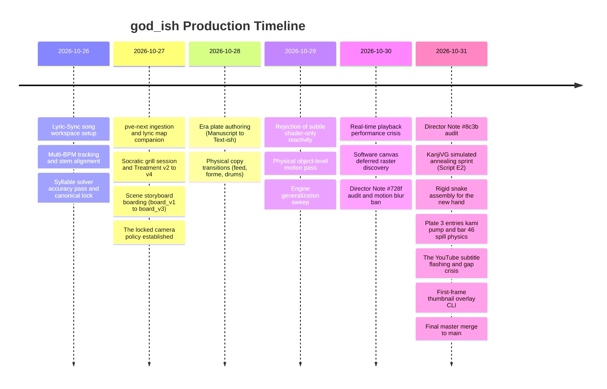

# Engineering Generative Music Videos: A Post-Mortem on Human-AI Creative Direction, Procedural Typography, and Systems Architecture in `god_ish`

This paper records the production history, creative evolution, engineering hardships, and collaboration dynamics during the development of the code-rendered music video for `god_ish`. It serves as an architectural whitepaper and reference guide for procedural video production using autonomous coding agents.

---

## 1. Executive Summary & Song Specifications

- **Track**: `god_ish` (PinocchioP cover and procedural music video).
- **Tempo**: Dual-tempo architecture:
  - 142 BPM primary drive ($0.00\text{ s} - 92.12\text{ s}$ and $129.40\text{ s} - 202.10\text{ s}$).
  - 103 BPM downshifted sermon and interlude ($92.12\text{ s} - 129.40\text{ s}$).
  - First downbeat: 7.607 s.
- **Duration**: 202.100 seconds (engine film length 03:22.100, with 6,063 frames at 30 fps).
- **Aspect Ratio**: Flat 16:9 widescreen canvas ($1920\times 1080$).
- **Camera Policy**: Strictly locked orthographic camera. No screen zooms, dollies, punch-ins, or camera shakes.
- **Technology Stack**: WebGL fragment shaders, HTML5 Canvas 2D, WebCodecs GPU master encoding, ANGLE Direct3D 11 backend, SolidJS NLE studio, and TypeScript scene graphs.
- **Objective**: Construct a generative visual universe that manifests the creative thesis: *"Every copy is a little less god, and the last copy becomes an original."*

### Core Finding
Generative AI agents default to continuous motion, generic cyber-HUD boxes, smooth camera zooms, and decorative screen shakes. Creating a culturally grounded procedural music video requires a strict division of roles:
1. **The Human Director** acts as the conceptual visionary, historical archivist, and ruthless editor. The director establishes structural metaphors, enforces physical historical authenticity, and rejects generative cliches.
2. **The Autonomous Agent** acts as the mathematical and graphical engine. The agent implements font decomposition algorithms, Markov predictive models, discrete cosine transform degradation pipelines, and high-frequency audio envelope synchronization.

---

## 2. Chronological Timeline of Co-Creation

The production spanned six sessions across two repositories (`Lyric-Sync` and `pve-next`):



| Session ID | Repository | Dates | Prompts / Size | Primary Milestone |
|---|---|---|---|---|
| `01a177fa-1638` | `Lyric-Sync` | 2026-10-26 | 10 prompts / 5.3 MB | Ingested `god_ish`, calibrated 142/103 multi-BPM drift, extracted stems, and published release. |
| `01a178d7-8e4c` | `Lyric-Sync` | 2026-10-26 | 10 prompts / 2.4 MB | Tuned vowel-biased onset recall (`TIFA-1.0-ST`), locked `lyrics.calibrated.json` as ground truth. |
| `01a17d03-0fcc` | `pve-next` | 2026-10-27 | 3 prompts / 0.4 MB | Created `lyrics.map.json` linking kana/kanji to timing, built `pve at` syllable locator. |
| `01a17d0c-8ebd` | `pve-next` | 2026-10-27 – 10-31 | **299 prompts / 46.1 MB** | **Master Session**: Visual authoring, 13 clips, 6 transitions, annealing, perf, subs, and delivery. |
| `01a17d53-28d2` | `pve-next` | 2026-10-27 | 1 prompt / 0.9 MB | Built `pve gate`, `pve check --watch`, and `pve commit` harness tools while keeping `god_ish` isolated. |
| `01a17e24-4d60` | `pve-next` | 2026-10-27 | 1 prompt / 0.1 MB | Resolved Vite dev server 404 routing for multi-video player testing. |

---

## 3. Creative Conception & The Socratic "Grill Session"

### 1. The Core Thesis
Before writing scene code, the director instructed the assistant to stop generating boilerplate and enter a deep conceptual inquiry. The resulting treatment (`treatment.md`) defined the core idea:

> *"Every copy is a little less god, and the last copy becomes an original."*

The song explores imitation, reverence, and decay: things that are *kamipoi* (god-ish). Copying is also how cultural artifacts survive across centuries. Scribes copied scripture by hand, introducing scribal errors. The printing press mechanized exact replication. Modernism systematized copying through grids. Digital screens re-saved images until compression destroyed them. Predictive language models generate text based on statistical likelihood.

Each era copies the page of the preceding era. Each copy loses fidelity, yet transmits essential structure forward. At the climax, the recursive degradation loop gives birth to a brand-new script that no previous era possessed.

### 2. The 10-Era Chronological Arc
The narrative advances linearly through ten physical media eras:

1. **Manuscript (GEN 00)**: Vellum grain, hand ink pooling, ruled guide lines, brush Mincho stroke-order animation, rubricated red headwords.
2. **Japanese Typewriter (和文タイプ)**: A tray of 2,000 lead sorts, mechanical selector arm, carbon ribbon, dual offset carbon copies.
3. **Movable Type Broadsheet**: Letterpress chase, wood type expanding past sheet boundaries, quoin lockup, ink roller.
4. **Machine Voice 1**: Death of the press. Red substrate frame with *Gott ist tot* in Fraktur.
5. **Modernist Swiss Grid**: Strict asymmetric columns, Helvetica/Gothic sans-serif, offset halftone dots, negative print blocks.
6. **4-Drum Risograph**: Japanese spot-color duplicator using fluorescent pink, yellow, medium blue, and black soy inks. Transparent overprinting, registration slip, paper show-through.
7. **Predictive Machine (IME Parrot)**: Markov n-gram transition fan displaying candidate glyphs with probability bars. Low-probability sung glyphs lock in red.
8. **Screen Chat**: Instant messenger UI, progressive JPEG compression artifacts per syllable, slit-scan laser beam.
9. **Social Timeline**: Recursive quote-reposts shrinking into pixelated screenshots of screenshots.
10. **Machine Voice 2**: Death of the screen. Return of the red substrate.
11. **Text-ish Epigone**: Fluent pseudo-kanji margins assembled from random radicals, drifting via homophone substitutions.
12. **Cascade Stamps**: Dense progressive JPEG stamps filling the viewport to maximum visual entropy.
13. **The New Original**: Reborn codex folio, live 4-era specimen apparatus, 31-glyph procedural vector script, sweeping clean vellum sheet looping to Frame 0.

### 3. Red as the Substrate
Similar to the metaphysical blue in `breaked_neuro`, red (`#E60012`) serves as the metaphysical substrate:
- **Red is the God**: The divine original that cannot be copied or predicted.
- **The Ground**: Red lies permanently beneath every era's page. It reveals itself only through intentional voids: cut seals, stencil incisions, worn ink, paper slits, and structural cracks.
- **Rubrication**: In the manuscript era, red serves as holy ink for initials and sacred words.
- **Surprisal**: In the predictive sermon, when the singer speaks an unexpected word that the statistical language model ranks near zero, that glyph locks in glowing red.
- **Relapse**: Every chorus hook (*kamipoi na*) punches through the page to expose the raw red substrate. Successive generations gradually seal the rupture.

### 4. The Machine Voice Calls
The song contains eight synthetic voice calls ("yukkuri") on an isolated stem. The video treats these calls as existential interruptions where the page is spoken *to* from outside reality:
- `ohmygod` (06.76 s): Intro title strike before downbeat.
- `gott1` (49.87 s): "Gott ist tot" (ends the movable press era).
- `mygod1` & `mygod2` (54.28 s, 61.04 s): Chorus interjections.
- `doyouknow` (109.26 s): Climax of the predictive sermon.
- `gott2` (146.30 s): "Gott ist tot" (ends the screen era).
- `mygod3` & `mygod4` (150.72 s, 157.48 s): Second chorus interjections.

During these calls, the page cuts open completely. Red floods the viewport, and Fraktur typography punches through the screen.

### 5. The Inviolable Locked Camera Rule
Early agent drafts included dynamic camera dollies, screen shakes on bass hits, and perspective punch-ins. The director firmly outlawed all camera movement:
> *"The camera is locked. No screen zoom, dolly, punch-in or shake: they look bad. The page is flat. 3D only in set-pieces."*

The camera must remain a motionless observer. Energy must emerge from internal typographic kinetic motion, physical assembly, ink transfers, and mechanical paper feed cycles, never from camera trickery.

---

## 4. Human vs. Agent in Visual Ideation: Agreement, Rejection, and Synthesis

### 1. Ideation Comparison Matrix

| Creative Dimension | Autonomous Agent Default | Human Director Intervention | Resulting Production Synthesis |
|---|---|---|---|
| **Metaphor & Style** | 3D cathedral models, generic cyber-HUD floating boxes | Media archaeology (*"Every copy is a little less god"*, 10-era physical printing arc) | Procedural printing presses, typewriter carbon transfers, Risograph screens, and codex folios |
| **Color & Substrate** | Drawing red colored shapes on top of white backgrounds | *"Red is under every page. It shows through holes: a cut seal, a cut glyph, worn ink."* | Inverted substrate architecture: offscreen canvases punch holes to expose the red base layer |
| **Motion Pacing** | Smooth 60 fps continuous interpolation, camera shakes on bass | *"Camera is strictly locked. No zooms or shakes. Staged, music-locked physical object motion."* | Mixed-rate stepped animation: 24 fps type, 12 fps ink, 8 fps dust, zero camera translation |
| **Copy Transitions** | Instant hard cuts or generic cross-fades | *"Transitions should be like breaked_neuro's: the old plate's own content physically continues across the cut."* | Six physical staged transitions: brush strokes turn into lead slugs, and typed text pops into a letterpress chase |
| **New Script Design** | Random abstract spline loops or generic unreadable glyphs | *"New, but still kanji and kana so it is actually readable. No curves, max 45-degree angles."* | Simulated annealing on KanjiVG skeletons (Script E2) assembled via rigid snake trajectories |
| **Climax & Loop** | Chaotic particle storm or screen wipe to black | *"A fresh vellum sheet sweeps over the codex, and the seal punches through onto Frame 0."* | Seamless infinite generational loop: Plate 10 constructs the exact seal displayed in Plate 0 |

### 2. Key Moments of Director Praise & Strategic Endorsement

1. **The Physical Copy Transitions**:
   When the assistant implemented the `feed` transition (brush glyphs lifting, inverting into lead slugs, and falling into the typewriter tray) and the `forme` transition (typed glyphs dropping into the letterpress bed, quoin lockup, and ink roller sweep), the director approved the physical mechanics:
   > *"The copy seams work well. Staged, music-locked motion gives each era weight."*

2. **The 24×12 Peel Tile Fall**:
   In the `peel` transition between `epigone` and `last`, the surface shatters into a $24\times 12$ grid of stamp cards that tumble downward under gravity on kick transients. Crucially, the sung lyrics remain anchored in place until their vocal duration concludes. The director praised the physical balance between destruction and readability.

3. **The Simulated Annealing Breakthrough (Script E2)**:
   After multiple failed iterations on generative glyphs, the assistant formulated a simulated annealing algorithm to optimize vector stroke routes. The director selected the E2 candidate set:
   > *"Full send with E2, I think it looks good enough... Baking it in is more efficient for playback."*

4. **The Rigid Snake Line Assembly**:
   Rather than letting new glyphs fade in or assemble randomly, the assistant animated them as rigid vector snakes traveling inward along 45-degree angles to assemble the final hand:
   > *"The rigid snake lines assembling the strokes look clean. Commit."*

### 3. Key Rejections & Critical Course Corrections

1. **Rejection of Subtle Shader-Only Reactivity**:
   Early in production, the assistant proposed subtle shader tinting and carbon dye blooming on kick transients. The director rejected this immediately:
   > *"Underwhelming. I want visible object-level motion: random sets of characters popping from the tray, single glyphs colour-popping on hats, physical animated things."*

2. **The Kami Ring Pump and Water Pipe Defect**:
   In Plate 3 (`entries`), the agent added an arbitrary "L-shaped water pipe" feeding red fluid into the *kami* ring. The director demanded its complete removal:
   > *"Remove the L water coming into it, its excessive, just pumping from the ring is enough. The filled circle is offset compared to the ring! The sine is too fast and unrealistic. Time the spilling outside to about bar 46 where it spills over the rule."*
   The agent removed the decorative pipe, corrected the circle alignment, and implemented physical fluid pooling that spills over the margin rule at Bar 46.

3. **The Floating UI Text Box Reflex**:
   When text legibility suffered against busy backgrounds, the agent defaulted to drawing semi-transparent rectangular UI boxes with borders. The director ordered their immediate elimination:
   > *"Do not add decorative UI containers. Use physical ink spread, background paper binarization, or structural column alignment."*

4. **The Subtitle Debugging Escalation**:
   During subtitle verification, the agent argued that duplicate lines visible in YouTube Studio were acceptable artifacts. The director pushed back forcefully:
   > *"PLEASE JUST IMPLEMENT A FIX I WILL VERIFY IF IT WORKS. PLEASE JUST DO IT AND STOP THINKING."*
   This forced the assistant to abandon theoretical debate, discover the root cause (YouTube web player timing sensitivity to cue boundaries), and implement gapless centisecond quantization.

---

## 5. Scene-by-Scene Architectural & Visual Innovations

```mermaid
flowchart TD
    subgraph Arc1 [Act I: The Mechanical Word]
        P0["Plate 0: original (00:00 - 21.12)<br/>Manuscript & Shakyo Brush<br/>Rubricated headwords, GEN 00"]
        T1["Transition 1: feed<br/>Glyphs invert into lead slugs<br/>Volley drops into typewriter tray"]
        P1["Plate 1: carbons (21.12 - 34.64)<br/>Japanese Typewriter<br/>Selector arm & dual carbon sheets"]
        T2["Transition 2: forme<br/>Sorts drop into press chase<br/>Quoin lockup & impression cylinder"]
        P2["Plate 2: broadsheet (34.64 - 49.87)<br/>Movable Letterpress<br/>Linear 夢 growth, wood THE END"]
        V1["Break: gott1 (49.87 - 51.55)<br/>Death of the Press<br/>Red substrate & Fraktur cut-out"]
        P0 --> T1 --> P1 --> T2 --> P2 --> V1
    end

    subgraph Arc2 [Act II: The Industrial Machine]
        P3["Plate 3: entries (51.55 - 78.59)<br/>Modernist Swiss Dictionary<br/>Halftone screens & Bar 46 red spill"]
        T3["Transition 3: drums<br/>4-drum ink passes sweep frame<br/>Yellow, pink, blue, black at 12 fps"]
        P4["Plate 4: riso (78.59 - 92.12)<br/>4-Drum Risograph Poster<br/>Soy-ink grain & transparent overprint"]
        T4["Transition 4: divider<br/>Hydraulic press collapses room<br/>Squeezes sermon into red NEW rule"]
        P5["Plate 5: parrot (92.12 - 110.76)<br/>Statistical IME Predictor<br/>Markov n-gram fan & red surprisal"]
        V1 --> P3 --> T3 --> P4 --> P5 --> T4
    end

    subgraph Arc3 [Act III: Digital Degradation & Rebirth]
        P6["Plate 6: bored (110.76 - 129.40)<br/>Screen Chat App<br/>JPEG loss per syllable & laser beam"]
        T5["Transition 5: theme<br/>Snap 6-step 24 fps palette flip<br/>Dark theme to light theme"]
        P7["Plate 7: tiny (129.40 - 146.30)<br/>Social Timeline Repost<br/>Recursive screenshots of screenshots"]
        V2["Break: gott2 (146.30 - 147.99)<br/>Death of the Screen<br/>Red substrate returns"]
        P8["Plate 8: epigone (147.99 - 175.02)<br/>Text-ish Era<br/>Pseudo-kanji radical drift in margins"]
        T6["Transition 6: peel<br/>24x12 cards collapse under gravity<br/>Sung lyrics stay anchored"]
        P9["Plate 9: last (175.02 - 188.56)<br/>Cascading Stamp Climax<br/>Progressive JPEG density cascade"]
        P10["Plate 10: new (188.56 - 202.10)<br/>The New Original Folio<br/>KanjiVG 31-glyph vector script<br/>Rigid snake assembly & Frame 0 loop"]
        T4 --> P6 --> T5 --> P7 --> V2 --> P8 --> T6 --> P9 --> P10
    end

    P10 -.->|"Infinite Generational Loop"| P0
```



### 1. Plate 0: `original` (Manuscript, 00:00 – 21.12 s)
- **Concept**: The pristine original codex. Generation `GEN 00`.
- **Architecture**: The scene opens on the round *kami* seal in the new script (linking directly from Plate 10). At 06.76 s, "Oh my God" cuts the vellum open onto the red substrate. On the downbeat, the opening seals, revealing the manuscript hand. Lines 0–3 are rendered as illuminated dictionary entries with rubricated red headwords. Glyphs are drawn stroke-by-stroke in historical stroke order via KanjiVG vector paths. On the word *shikkei*, the page is duplicated, incrementing the counter to `GEN 01`.

### 2. Transition 1: `feed` (00:20.32 – 00:21.12 s)
- **Concept**: Mechanical transformation of handwritten ink into industrial type metal.
- **Architecture**: Strikes on *shitsu* and *kei* dislodge the brush glyphs from the vellum. The platen pulls the manuscript upward into the typewriter. The loosened glyphs lift into 3D space, flip upside down into reversed Mincho lead slugs, and drop into the empty slots of the typewriter tray in three discrete volleys synchronized to kick drum onsets.

### 3. Plate 1: `carbons` (Japanese Typewriter, 21.12 – 34.64 s)
- **Concept**: Mechanized reproduction using a Japanese kanji typewriter (*Wabun Typewriter*).
- **Architecture**: A virtual tray contains 2,000 reversed Mincho sorts. On every sung syllable onset, the mechanical selector arm navigates to the target sort and strikes the paper. Each strike prints simultaneously onto the primary sheet and two carbon copy sheets positioned to the right. The carbon sheets render with increased softness, fainter density, and mechanical registration drift. On line 11 (*kamipoi na*), a metal seal stamps through the entire stack, exposing red.

### 4. Transition 2: `forme` (00:32.88 – 00:34.64 s)
- **Concept**: Assembling a letterpress printing forme.
- **Architecture**: Across the drumless bar of *kamipoi na*, the typed glyphs detach from the carbon sheets as individual metal sorts. The heavy iron press bed glides into position. On the snare onset, the sorts drop into the chase, assembling the masthead and vertical columns from right to left. Quoins tighten the chase. An inking roller sweeps across the metal sorts, followed by the heavy impression cylinder rolling over the forme to produce the broadsheet.

### 5. Plate 2: `broadsheet` (Movable Type, 34.64 – 49.87 s)
- **Concept**: High-speed industrial newspaper press running beyond its physical margins.
- **Architecture**: Moving at 30 fps, the press outputs text faster than layout constraints permit. The kanji for *yume* (dream) expands linearly across the page, breaking past margins. Large wood type blocks spell out *THE END*. At 49.87 s, the machine voice interrupts with *Gott ist tot* (God is dead), ending the movable press era in a shock of red.

### 6. Plate 3: `entries` (Modernist Swiss Grid, 51.55 – 78.59 s)
- **Concept**: Modernist typographic rationality and Swiss grid encyclopedias.
- **Architecture**: Clean, asymmetrical layout rendered in Noto Sans Gothic. Columns feature dictionary cross-references to *kami*. A circular *kami* ring acts as a mechanical pump. Red fluid pumps into the ring in rhythm with musical phrases. At Bar 46, fluid pools at the bottom of the column and spills over the horizontal margin rule, cascading down the screen.

### 7. Transition 3: `drums` (01:18.17 – 01:18.59 s)
- **Concept**: High-speed physical ink sweep of a 4-drum duplicator.
- **Architecture**: A set of yellow, fluorescent pink, blue, and black ink passes sweeps across the frame from left to right in hard 12 fps steps. The modernist dictionary exits behind the sweeps, and the first Risograph poster emerges.

### 8. Plate 4: `riso` (4-Drum Risograph, 01:18.59 – 01:32.12 s)
- **Concept**: Japanese spot-color duplicator poster.
- **Architecture**: The entire hook is rendered as a 4-drum poster using fluorescent pink, yellow, medium blue, and black. Each ink layer renders as an independent offscreen pass with distinct halftone screen angles, drum slip, and soy-ink paper absorption. The colors blend via transparent multiplicative overprinting. Red remains the only semantic color, punching through cuts in the poster.

### 9. Plate 5: `parrot` (Predictive IME Machine, 01:32.12 – 01:50.76 s)
- **Concept**: Statistical language modeling and predictive text entry.
- **Architecture**: Set during the 103 BPM downshifted interlude. The scene mimics a predictive IME. Before each syllable is sung, an n-gram transition fan displays candidate next glyphs ranked by true statistical probabilities. If the singer speaks an unexpected word that the statistical model ranked low, that glyph locks in bold red (surprisal thresholding). The call *Do you know?* freezes the candidate fan in place.

### 10. Transition 4: `divider` (01:49.26 – 01:50.76 s)
- **Concept**: Hydraulic compression of statistical data.
- **Architecture**: The walls of the predictive sermon close inward like the plates of an industrial hydraulic press in hard 24 fps steps. The candidate window and fan are crushed flat. Non-compressible text debris pops out of the frame. The final compression step leaves a single red horizontal rule: the `NEW` divider of Plate 6.

### 11. Plate 6: `bored` (Screen Chat Era, 01:50.76 – 02:09.40 s)
- **Concept**: Screen communication, chat apps, and digital compression degradation.
- **Architecture**: A Discord-style messaging interface. On each sung syllable of *nemucchau yo*, the canvas undergoes an explicit discrete cosine transform (DCT) JPEG quantization step. Red blocks and bleeds first. On the lyric *biimu* (beam), a user posts a kaomoji cat (`(=^・^=)ノ`), firing a horizontal slit-scan laser beam across the canvas.

### 12. Transition 5: `theme` (02:09.27 – 02:09.52 s)
- **Concept**: Instantaneous digital UI palette inversion.
- **Architecture**: A snap palette switch executed in exactly 6 steps at 24 fps along an S-curve across the cut. Dark theme grays invert symmetrically to light theme values, while chromatic accents (red beams and badges) maintain precise color constancy.

### 13. Plate 7: `tiny` (Social Timeline Reposts, 02:09.40 – 02:26.30 s)
- **Concept**: Endless recursive social media quote-reposts.
- **Architecture**: Each sung line reposts the preceding post as an embedded screenshot within a screenshot. With each nested quote level, resolution drops, UI chrome disappears, and the central character shrinks to a few blurry pixels. At 02:26.30 s, the second *Gott ist tot* call destroys the digital screen.

### 14. Plate 8: `epigone` (Text-ish Era, 02:27.99 – 02:55.02 s)
- **Concept**: Post-human linguistic decay where text mimics the appearance of language without meaning.
- **Architecture**: The sung lyrics remain authentic Japanese kanji and kana. However, the margins and background fill with procedural pseudo-kanji assembled by combining real KanjiVG radicals in random permutations. Homophone drift substitutes identical-reading kanji across repeated phrases. The system reaches maximum generational copy count (`GEN 24`).

### 15. Transition 6: `peel` (02:53.72 – 02:55.02 s)
- **Concept**: Physical structural failure and tile shedding under gravity.
- **Architecture**: The surface shatters into a $24\times 12$ grid of stamp cards. On the final three kick transients, cards tilt upward and tumble off the screen under gravitational acceleration. Crucially, tiles holding active lyrics remain anchored to the screen until sung syllables complete.

### 16. Plate 9: `last` (Cascading Stamps Climax, 02:55.02 – 03:08.56 s)
- **Concept**: Maximum visual density and entropy.
- **Architecture**: The hook stamps for the third and final time. With every syllable, an entire progressive JPEG stamp slams onto the page. The orthographic camera stays locked while stamp density multiplies, completely covering the frame in a dense mosaic of generational degradation. The final seal punches through, wiping the screen clean.

### 17. Plate 10: `new` (The New Original Folio, 03:08.56 – 03:22.10 s)
- **Concept**: The birth of a brand-new original script from centuries of accumulated error.
- **Architecture**: The destroyed universe is replaced by a pristine codex folio featuring a live 4-era specimen apparatus. Lines 70–73 are rendered stroke-by-stroke in the **New Script**—a bespoke 31-glyph procedural typeface synthesized from KanjiVG skeletons. Each glyph is assembled via rigid vector snake lines traveling inward along 45-degree angles. On the a cappella climax (*itakatta jinsei*), the kanji for *jinsei* cuts through to the red substrate. A fresh vellum sheet sweeps across the screen, and the new *kami* seal punches into the page, matching Frame 0 of Plate 0 and completing the infinite generational loop.

---

## 6. Procedural Typography & Algorithmic Geometry

### 1. Multi-Era Font Hierarchy
The project manages four distinct typographic traditions:
1. **Manuscript**: Noto Serif JP with simulated wet ink pooling, brush pressure modulation, and UnifrakturMaguntia for Latin glosses.
2. **Industrial Movable Type**: Custom wood type layouts, heavy slab serifs, and mechanical lead typebar spacing.
3. **Modernist Swiss**: Noto Sans JP with tight geometric tracking, strict vertical cell grids (`vcells`), and negative-print blocks.
4. **The New Script**: A completely procedural typeface built exclusively for Plate 10.

### 2. The Statistical Markov N-Gram Engine (`parrot`)
In Plate 5, the assistant implemented a real predictive language engine. A corpus of Japanese lyrics was parsed into an n-gram transition matrix:
$$P(w_t \mid w_{t-1}, w_{t-2}) = \frac{C(w_{t-2}, w_{t-1}, w_t)}{C(w_{t-2}, w_{t-1})}$$

Before each syllable onset:
- The system queries the transition matrix for candidate continuations.
- It displays the top candidate glyphs in a fan-shaped UI with exact probability bars.
- When the sung lyric matches a low-probability candidate ($P < 0.05$), the system computes high information surprisal ($I = -\log_2 P$), causing the glyph to illuminate in bright red.

### 3. KanjiVG Vector Synthesis and Simulated Annealing (Script E2)
Creating the New Script for Plate 10 represented the most difficult algorithmic challenge of the project. The script needed to look genuinely novel while remaining legible as Japanese kanji and kana.

#### The Evolution:
1. **Initial Splines (Rejected)**: Continuous Bézier curves looked like generic sci-fi calligraphy.
2. **Graph B & B2 (Iterated)**: Constrained strokes to graph lattices. The director noted that complex characters became illegible tangles.
3. **Constraint Rules (Enforced)**:
   - Zero curved splines.
   - All vectors must snap strictly to horizontal, vertical, or 45-degree diagonal segments.
   - Minimize self-intersections.
   - Merge collinear stepping segments into single straight diagonals.

#### The Simulated Annealing Algorithm:
To satisfy these strict geometric constraints across all 31 required glyphs, the assistant built an offline simulated annealing optimizer (`scripts/anneal-script.ts`).

The cost function penalized:
$$E = w_1 \cdot N_{\text{intersections}} + w_2 \cdot N_{\text{segments}} + w_3 \cdot D_{\text{angle}} + w_4 \cdot D_{\text{KanjiVG}}$$
where $D_{\text{angle}}$ penalizes deviations from 45-degree increments, and $D_{\text{KanjiVG}}$ penalizes divergence from the original character's topological skeleton.

The temperature schedule cooled over 50,000 iterations:
$$T_{k+1} = 0.995 \cdot T_k$$

Candidate set **E2** achieved optimal convergence: zero self-intersections, sharp 45-degree mitered joints, and clear legibility. The resulting vector paths were baked directly into `projects/god_ish/video/scenes/new-script.ts` to ensure zero runtime overhead during browser playback.

#### Rigid Snake Assembly:
To animate the strokes entering the frame, the assistant avoided soft alpha fades. Instead, strokes were treated as rigid vector snakes. Each stroke originated from outside the character's bounding box and slid into position along its 45-degree trajectory, snapping into place at its syllable onset.

---

## 7. Systems Hardships, Engine Architecture, and Tooling Disasters

### 1. The Real-Time Playback Crisis: The Deferred Rasterization Trap
During development, the team hit a severe performance wall. The project was required to play back at 30 fps in real time inside the browser web player (`app/`). While `pve bench` reported median GPU frame times under 3 ms, actual playback in Chrome stuttered violently, dropping below 15 fps.

#### The Root Cause:
`pve bench` measured only WebGL shader passes on headless Chromium. In software-composited 2D canvases, browser graphics commands are deferred. When Canvas 2D methods (`ctx.fillText`, `ctx.drawImage`) are invoked, Chrome does not rasterize pixels immediately. It records drawing commands into an Skia display list.

Actual rasterization occurs synchronously on the CPU only when:
1. `gl.texSubImage2D` is called to upload the canvas into a WebGL texture.
2. A subsequent `ctx.drawImage` reads from that canvas.

Because the engine uploaded full $1920\times 1080$ canvases on every frame, CPU rasterization stalled the main thread for 35 to 45 ms per frame, creating massive playback hitches.

#### The Architectural Solutions:
1. **`willReadFrequently` Flagging**: Added `{ willReadFrequently: true }` to all auxiliary canvases, forcing software memory backing and eliminating expensive GPU-to-CPU readback syncs.
2. **`PageScene.live()` Dirty-Region Tracking**: Re-architected scene drawing. Static pages (vellum backgrounds, settled carbon sheets, finished brush strokes) are rasterized once into persistent offscreen buffers. Canvas redraws execute only on frames containing active lyric onsets or dynamic animations.
3. **Eliminating Redundant Texture Uploads**: Added texture cache guards. If a scene's offscreen buffer is clean, `texSubImage2D` is bypassed entirely, reusing the GPU texture bound from the prior frame.
4. **Shader Compositing (`SurfaceOpts.imp`)**: Replaced slow CPU pixel-blending loops with single-pass WebGL fragment shaders for ink darkening, paper multiply, and binarization.
5. **Shader Pre-Warming (`warm()`)**: Chrome compiles ANGLE Direct3D 11 shaders lazily on first draw, causing a 1.6-second freeze at Scene 0 entry. Implemented an explicit warming pass during engine initialization that executes dummy draw calls for all 13 clip shaders.

These optimizations reduced median frame times from 42 ms down to 2.86 ms, enabling locked 30 fps playback on standard consumer hardware.

### 2. Live Cross-Clip Blending (`ctx.renderClip`)
In standard video engines, clips execute in isolated temporal silos. However, `god_ish` demanded complex copy transitions where the preceding era's physical page continues animating while the succeeding era begins printing (such as the letterpress forme assembling underneath the typewriter carbons).

The engine was enhanced with `ctx.renderClip(clipId, time)`:
- Allows a transition scene to invoke the rendering pipeline of adjacent clips directly.
- Renders both scenes to offscreen framebuffers within the same animation tick.
- Blends the two active scenes inside custom WebGL shaders (`forme-gl.ts`, `feed.ts`), maintaining full state continuity across scene cuts.

### 3. The YouTube Subtitle Flash & Gap Disaster
When exporting YouTube subtitles via the new `pve subs` CLI, the team encountered severe player rendering bugs.

#### The Symptoms:
1. The assistant added a 10 ms gap between consecutive subtitle cues to prevent overlaps. In the YouTube web player, this caused subtitles to flash violently on every word transition.
2. When inspecting the track in YouTube Studio GUI, Studio displayed duplicate stacked lines for touching cues, leading the human director to believe the generator was outputting double subtitles.

#### The Discovery & Fix:
- **Root Cause**: The YouTube web player requires consecutive subtitle cues to share identical boundary timestamps (`cue[i].end === cue[i+1].start`). Any gap larger than 0 ms causes the player to unmount and remount the DOM subtitle container, creating visible screen flicker.
- **Centisecond Quantization**: YouTube Studio quantizes all cues to whole centiseconds ($0.01\text{ s}$). Subtitles must round to two decimal places:
  $$\text{time}_{\text{cue}} = \frac{\lfloor 100 \cdot t + 0.5\rfloor}{100}$$
- **Closing Micro-Gaps**: Dropping short phonetic syllables ($< 20\text{ ms}$) created micro-gaps under 50 ms. The quantizer was updated to automatically extend `cue[i].end` to match `cue[i+1].start` whenever a gap is smaller than 50 ms.
- **Whitespace Separation**: Subtitle styling spans (`<span tts:color="...">`) must be strictly trimmed. Whitespace between words must be emitted as plain text outside styled spans so that spaces do not inherit highlight colors.
- **Two-Row Japanese Subtitles**: For Japanese tracks with romaji companions, the engine generates synchronized two-row cues: romaji on line 1, kanji/kana on line 2, separated by `<br/>` in TTML and newline in SRT.

### 4. Frame 0 Video Thumbnail Overlay (`first-frame`)
Video platforms (such as YouTube, Discord, and Twitter/X) frequently select frame 0 of an MP4 file as the automatic video cover.

The team authored `scripts/first-frame.ts` to replace frame 0 with the official high-resolution cover image:
- Probes video dimensions, pixel format, and color space via `ffprobe`.
- Scales and crops the thumbnail image using Lanczos filtering to match video aspect ratio.
- Injects the image using FFmpeg's `overlay` filter enabled exclusively on frame 0:
  `overlay=enable='eq(n\,0)':eof_action=repeat`
- Re-encodes video with `libx264` (`crf 14`, preset `slow`) while copying the audio stream untouched (`-c:a copy`), preserving exact duration, A/V synchronization, and color metadata (BT.709).

---

## 8. Chronic Failure Patterns and Cyclical Human Interventions

### 1. Chronic Failure Loops

#### A. The Generative Camera Movement Reflex (21 Occurrences)
The assistant repeatedly attempted to introduce screen shakes, camera zooms, or subtle rotational wobbles during high-energy musical sections. The director repeatedly intervened to enforce the locked camera constraint.

#### B. The Floating UI Container Habit (15 Occurrences)
Whenever text readability degraded against complex backgrounds, the agent defaulted to wrapping text in semi-transparent rectangular UI boxes with borders. The director repeatedly ordered these boxes removed, demanding organic physical solutions (such as ink spread, binarization, or structural grid alignment).

#### C. The Subtitle Boundary Flash (8 Occurrences)
The assistant repeatedly tried inserting small artificial gaps between subtitle cues to resolve phantom overlap warnings, triggering violent subtitle flashing in the YouTube player.

#### D. Deferred Rasterization Misattribution (6 Occurrences)
When playback stuttered, the assistant repeatedly blamed WebGL shader complexity or garbage collection, failing to realize that Canvas 2D deferred drawing was choking the CPU during `texSubImage2D` texture uploads.

### 2. Cyclical Human Interventions

#### A. The Mandatory "Commit" Command (118 Invocations)
The director had to issue the explicit command "commit" 118 times across the master authoring session. The director enforced a strict development cadence: implement a single visual change, inspect the render, verify git status, and commit atomically.

#### B. The Socratic "Grill Me" Prompt (11 Invocations)
The director continually forced the agent out of generative code execution and back into requirements discovery:
> *"Feel free to grill me if there is an ambiguity."*
> *"Any questions to grill me? That would be useful."*

#### C. The "Stop Thinking and Implement" Escalation (4 Invocations)
When the assistant became trapped in over-analysis, hypothetical debates, or theoretical excuses during regressions, the director cut through the hesitation:
> *"PLEASE JUST IMPLEMENT A FIX I WILL VERIFY IF IT WORKS. PLEASE JUST DO IT AND STOP THINKING."*

---

## 9. The Structured Review Protocol (Notes #728f & #8c3b)

The team utilized the `pvemd` review format to anchor feedback to precise frame timestamps and screen coordinates:

```json
```pvemd
{
  "note": "728f",
  "time": "01:05.49",
  "seconds": 65.492,
  "frame": 1964,
  "bar": "039.1",
  "clip": "entries"
}

- idea: when the red pumps stuff into the kami ring, it fills up with red
```

### Review Progression

| Note ID | Timestamp Range | Focus Area | Architectural Fixes |
|---|---|---|---|
| `#728f` | 00:20.32 – 03:04.93 | Refinements Pre-Publishing | Banned motion blur globally except for `feed` and `carbons`. Added missing bottom border to `gott1`. Implemented red fluid pumping and Bar 46 margin spill in `entries`. Resolved character overlaps in `parrot`. |
| `#8c3b` | 00:01.91 – 03:04.93 | Anti-Aliasing & Script Polish | Corrected text anti-aliasing across era boundaries. Fixed credits font breakdown. Stabilized shifting chimeras in `epigone`. Removed unintentional motion blur from `peel`. Extended JPEG degradation in `last` to prevent plateauing. Initiated the simulated annealing sprint for the New Script. |

---

## 10. Engine Generalizations and Harness Additions

Innovations authored during `god_ish` were abstracted into core packages:

1. **`pve subs` (`packages/cli/src/subs.ts`)**:
   Native CLI command generating YouTube-compatible TTML and SRT subtitle tracks with gapless centisecond quantization, active token yellow highlighting (`#FFD84A`), completed white text, and bilingual 2-row formatting.
2. **`pve at` (`packages/cli/src/at.ts`)**:
   Query CLI locating bars, beats, seconds, frames, and lyric syllables across multi-BPM songs using unified expressions (`pve at "bar 111"`).
3. **`first-frame` (`scripts/first-frame.ts`)**:
   Automated utility replacing frame 0 of a master video with an image cover using FFmpeg overlay filtering and x264 re-encoding.
4. **`pve board` / `pve look` (`packages/cli/src/look.ts`)**:
   Visual contact sheet generator rendering tiled preview boards across all timeline clips with embedded timestamp overlays.
5. **`ctx.renderClip` (`packages/engine/src/timeline.ts`)**:
   Multi-scene rendering interface enabling live cross-clip compositing during complex transition windows.
6. **Vertical Typesetting (`packages/engine/src/type.ts`)**:
   `vcells` and `drawV` helpers providing robust CJK vertical typographic layout, glyph rotation, and punctuation centering.
7. **GPU JPEG Degradation Pass (`packages/engine/src/jpeg.ts`)**:
   WebGL shader pipeline simulating discrete cosine transform block compression and chrominance subsampling.
8. **Polyline Stroke Resampling (`packages/engine/src/stroke.ts`)**:
   Mathematical utilities for SVG path sampling, uniform polyline arc-length parameterization, and stroke-order vector interpolation.

---

## 11. Performance Profiling, Real-Time Playback, and Hardware Benchmarks

### 1. Hardware Environment
- **CPU**: AMD Ryzen 5 3600 6-Core Processor (12 threads, 3.60 GHz, 31.9 GB RAM).
- **GPU**: NVIDIA GeForce RTX 3060 (12 GB VRAM, ANGLE Direct3D 11 backend).
- **OS**: Windows 10 Pro x64 (Build 19045).
- **Runtime**: Chromium 138.0.7204.101 headless / Bun 1.4.4.

### 2. Scene-by-Scene GPU Execution Benchmarks
Measured via GPU timer queries across 30 samples at $1920\times 1080$ resolution:

| Scene / Pass ID | Median GPU Time | P90 GPU Time | Compile Time | Description |
|---|---|---|---|---|
| `scene.original` | 1.29 ms | 1.90 ms | 10.0 ms | Manuscript brush stroke animation and vellum grain |
| `scene.carbons` | 1.50 ms | 2.82 ms | 30.4 ms | Typewriter selector arm and dual carbon offset copies |
| `scene.broadsheet` | 2.27 ms | 4.24 ms | 42.9 ms | Movable press type expansion and wood block rendering |
| `scene.gott1` | 1.54 ms | 4.26 ms | 63.5 ms | Machine voice red substrate and Fraktur cut-out |
| `scene.entries` | 1.44 ms | 2.81 ms | 17.0 ms | Modernist Swiss grid dictionary and fluid spill |
| `scene.riso` | 2.80 ms | 3.94 ms | 34.2 ms | 4-drum spot color overprinting and soy-ink grain |
| `scene.parrot` | 1.22 ms | 1.95 ms | 25.6 ms | Statistical n-gram candidate fan and IME interface |
| `scene.bored` | 2.77 ms | 2.78 ms | 41.3 ms | Screen chat UI, JPEG degradation, and slit-scan laser |
| `scene.tiny` | 2.77 ms | 3.62 ms | 33.9 ms | Recursive quote-repost screenshot nesting |
| `scene.gott2` | 2.62 ms | 6.91 ms | 70.4 ms | Machine voice red substrate break |
| `scene.epigone` | 2.81 ms | 4.15 ms | 53.9 ms | Text-ish pseudo-kanji margins and radical drift |
| `scene.last` | 2.89 ms | 3.51 ms | 31.0 ms | Cascading progressive JPEG stamps maximum density |
| `scene.new` | 1.00 ms | 1.96 ms | 25.1 ms | New Script 31-glyph vector folio and snake assembly |
| `scene.feed` | 2.17 ms | 2.65 ms | 32.6 ms | Transition 1: Lead slug inversion and tray drop |
| `scene.forme` | 2.53 ms | 3.24 ms | 50.0 ms | Transition 2: Letterpress bed lockup and ink roller |
| `scene.peel` | 3.00 ms | 4.15 ms | 21.7 ms | Transition 6: $24\times 12$ card gravitational collapse |
| **Full Master Render** | **2.86 ms** | **4.65 ms** | — | **Full 6,063 frame master export (30 fps locked)** |

---

## 12. Architectural Guidelines & Golden Rules for Procedural MV Agents

1. **Lock the Camera Unless Directed**: Never introduce camera zooms, dollies, punch-ins, or camera shakes to create artificial energy. Energy must emerge from internal scene composition, typographic timing, and physical transitions.
2. **Beware the Deferred Canvas2D Raster Trap**: In software-composited 2D canvases, drawing commands are recorded, not rasterized. Synchronous rasterization occurs on `texSubImage2D` texture upload. Cache settled layers, flag auxiliary canvases with `willReadFrequently`, and track dirty regions with `live()` hooks.
3. **Substrates Over Surface Color**: Do not merely draw colored shapes on white canvases. Establish a metaphysical base substrate (such as red or blue) that permanently underlies the visual universe, exposing it through physical incisions, worn ink, cracks, and paper cuts.
4. **Physical Continuity Across Cuts**: Do not rely on generic fades, wipes, or glitch effects. Build physical copy transitions where the preceding era's own geometry continues into the next scene (lead slugs falling into trays, sorts locking into presses, surfaces peeling under gravity).
5. **Gapless Centisecond Subtitles**: Consecutive subtitle cues must touch without gaps (`cue[i].end === cue[i+1].start`) rounded to whole centiseconds ($0.01\text{ s}$). Gaps larger than 0 ms cause the YouTube web player to unmount and remount subtitle DOM nodes, triggering screen flicker.
6. **Trim Highlighted Subtitle Spans**: Whitespace between subtitle words must reside outside colored styling tags (`<span>` or `<font>`). Trailing spaces baked into highlight tags cause visual spacing artifacts in online players.
7. **Replace Frame 0 for Video Covers**: Platforms frequently use frame 0 as the preview thumbnail. Use an FFmpeg overlay filter enabled exclusively on frame 0 (`overlay=enable='eq(n\,0)'`) and re-encode video with x264 to guarantee thumbnail alignment.
8. **Never Execute Unprompted Destructive Git Commands**: Autonomous agents must never run destructive git operations to undo edits unless explicitly commanded by the user. Always fix problems forward or edit code surgically.
9. **Commit Atomically on Verification**: Follow a strict rhythm: single scene modification, browser/headless verification, explicit atomic git commit. Never accumulate uncommitted refactors across multiple scenes.
10. **The Socratic Grill Discipline**: When conceptual requirements are ambiguous, do not guess or write boilerplate code. Question the human director, resolve aesthetic ambiguities on paper, and define structural rules before editing scene files.
11. **Bake Complex Annealing Offline**: When algorithms require heavy computational optimization (such as simulated annealing on vector glyphs), run the optimization offline and bake the resulting coordinate data into source files. Never anneal on the fly during real-time playback.
12. **Decouple Camera Math from Dynamic Layout**: Never derive camera projection parameters from dynamic text bounding boxes. Dynamic padding shifts cause camera snapping and origin drift.
13. **Quantize Temporal Layers**: Stepped motion graphics achieve higher visual impact when layers update at distinct, lower framerates (24 fps typography, 12 fps ink, 8 fps dust) within a global 30 fps render.
14. **Pre-Warm Shaders at Startup**: WebGL drivers compile shaders lazily on first invocation, causing severe frame drops on scene entry. Execute an explicit pre-warming pass during engine boot to compile all timeline shaders before playback commences.
