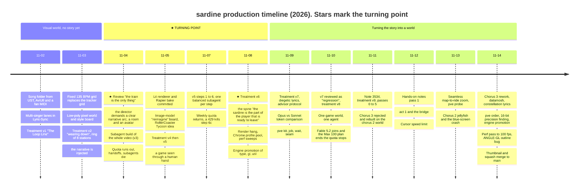
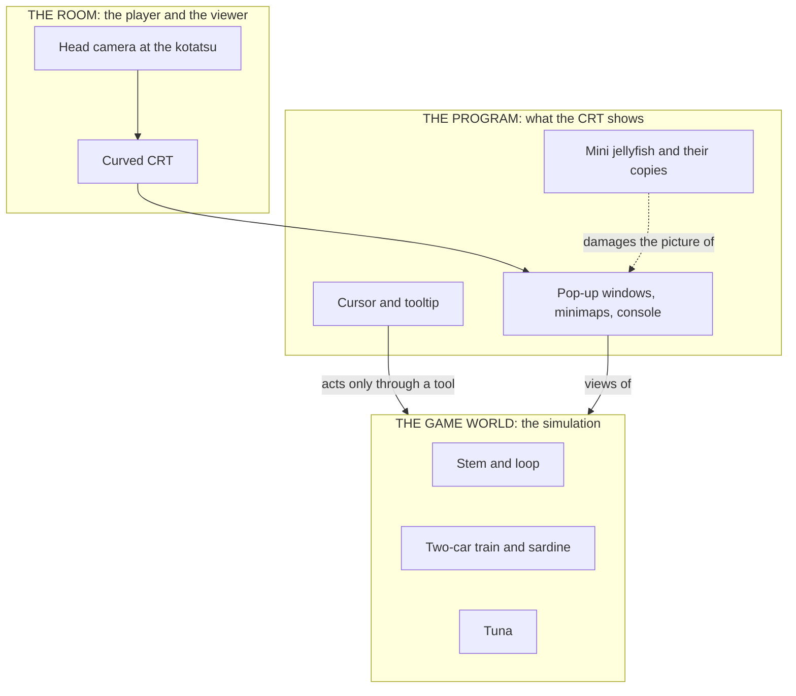

# Wearing Down a Game: A Post-Mortem on Nine Rebuilds, a Lit 3D Pixel Engine, and Human-AI Direction in `sardine`

This paper records how the music video for `sardine` was made. It covers twelve days, nine treatments, about 640 director prompts and 86 commits that touch the project. It is the third paper in this series. The first two (`breaked.md`, `god_ish.md`) describe projects that had one clear idea and a locked camera. `sardine` had neither. It is a 3D game world with a moving camera, a cursor that acts like a person, and a story that the song does not state. Most of the cost went into finding the idea and into making the world behave.

The paper is a reference for people who direct code-rendered videos with agents. It is about the creative process first: how the idea was found, how the director and the agents argued, and what each rebuild taught. The technical parts are short and only cover what changed a creative decision. It states facts, shows the evidence, and marks anything that is a guess as `[INFERENCE]`. Section 19 says how the evidence was collected and where it is thin. The director's words are quoted with their spelling.

---

## 1. Executive Summary and Song Specifications

| Item | Value |
|---|---|
| Track | Koronba, *イワシがつちからはえてくるんだ* (A Sardine Grows from the Soil). A UTAU song with a lead voice, a chorus double and a counter voice |
| Tempo | 135 BPM, on an exact fixed grid. 96 bars. 1 bar = 1.778 s. 1 beat = 0.444 s |
| Duration | 170.667 s |
| Frame rate | 36 fps (16 frames per beat) |
| Picture | Lit low-poly 3D at 640x360, scaled x3 with nearest sampling to 1920x1080. An ordered 4x4 Bayer dither at 24 levels |
| Clips | 11: chirp, intro, verse_1, chorus_1, chorus_1b, bridge, interlude, verse_2, chorus_2, chorus_3, outro |
| Camera policy | The opposite of `god_ish`. Many cameras. Each one must feel like a person controls it (see section 9) |
| Stack | Three.js with a custom atlas-lit material, Rapier deterministic physics baked at `init()`, a `TextLayer` for all interface pixels, WebGL2, headless Chrome on ANGLE over D3D11 |
| Code at the end | 103 scene files, about 25,300 lines in `projects/sardine/video/scenes/`. 13 engine modules promoted out of the project, about 2,700 lines. A 729-line treatment. A 1,147-line generated API index (`KIT.md`) |
| History | 86 commits touch `projects/sardine`. The squash merge to `main` is `9d64fc1`: 232 files, +64,296 and -494 lines |
| Authors | A human director (credited as "idea guy: FM") and Claude agents. The on-screen credit reads `VISUALS: CLAUDE FABLE 5.2 & OPUS 5.5, GEMINI 4 ARGON` |
| Cost | About \$979 at list API prices for the sardine work alone (section 8.6). An estimate from the logs, not a bill |

### Core findings

1. **The idea came last, and it came from the director's constraints, not from the agent's proposals.** Three rounds of questions produced a theme ("wearing down") on day 2. The story (a player who does not want to move out, and an avatar that does) came on day 5. The rules that made the video work came on day 9 and 10, as notes about what looked wrong.
2. **A sequential single agent beat an orchestrator with subagents.** The director tested both ways on the same project and said so in writing (section 8). The subagent workflow cost more quota and made the scenes "more disjointed, and more bugs".
3. **The agent is strong at systems and weak at judging pace.** It built a deterministic physics bake, a shared game world, a datamosh with motion vectors and a chunked world unload. It also judged every shot from still images, and stills do not show speed, pacing or camera motion. The agent said this itself after v7 failed.
4. **Most of the hard bugs were "a frame left state behind".** The preview looked wrong on first play and right after a scrub. The cause was never in the picture code. It was in order dependence. One of the worst false alarms came from the GPU itself (section 13.2).
5. **Small, exact rules from the director did more than large plans.** "All tool tips since the beginning of GUI have always followed the cursor". "The beams ... need to anticipate the camera so its true 3d with no tricks". "Real cursor are always on top". Each one removed a whole class of faults.
6. **The harness grew because the director kept asking for numbers.** `pve kit`, `job`, `wait`, `seam`, `probe`, `order`, `perf --draws` and `still --precision float` all started as an agent writing a throwaway script and the director saying "worth updating the cli for this".
7. **A bigger plan and a stronger model changed the pace of the project.** The director bought the Max 100 plan and brought in Fable 5.2 on 11-10. The quota stops of the first week ended. The two biggest creative rebuilds, v8 (one game world) and the v9 passes, took two days with about 34 director prompts (section 8.3).

---

## 2. Chronological Timeline of Co-Creation

Dates are local (UTC+7). Prompt times in the session logs are UTC, so a late-evening local prompt can fall on the next UTC day.



### Sessions

| Session | Dates | Prompts | Size | Role |
|---|---|---|---|---|
| `01a17d0c-8ebd` | 10-27 to 11-05 | 100 of 403 are sardine | 63.9 MB | Song setup, treatments v1 and v2, v3 renderer. The first 303 prompts are `god_ish` |
| `01a1ad7d-4ba3` | 11-05 to 11-09 | 120 | 19.6 MB | v4 to v7. The subagent-per-pass era and its end |
| `01a1c0d8-12e2` | 11-09 to 11-14 | 392 | 52.0 MB | Refactor sweep, v8, v9, hands-on notes, perf, merge |
| `01a1abe6-9206` | 11-05 to 11-08 | 2 | 0.3 MB | Contact sheets of all eleven scenes |
| `01a1b91f-1ca4` | 11-08 | 7 | 1.3 MB | The verse 1 bar 13 performance spike |
| `01a1d076-b710` | 11-12 | 10 | 2.2 MB | Studio lag on hot reload, load time, the memo cache |
| `01a1c057-247a` | 11-09 | 1 | 0.5 MB | Opus vs Sonnet token comparison |
| `01a1a6b5`, `01a1a6e8`, `01a1a70c` | 11-04 | 1 to 3 each | small | Fullscreen player controls, what "drainboard" means, extracting an image-model chat log |

The sardine sessions hold about 640 director prompts. They arrive in this rhythm (UTC dates):

| Date | Prompts | What dominated |
|---|---|---|
| 11-02 | 33 | Song setup and Lyric-Sync |
| 11-03 | 20 | Pixel world, v2 grilling |
| 11-04 | 26 | Full-MV attempt with subagents |
| 11-05 | 32 | Reimagine board, v4/v5, subagent build |
| 11-07 | 14 | v5 steps, quota choreography |
| 11-08 | 58 | v6, render hang, refactor, perf |
| 11-09 | 57 | v7, token study, CLI audit |
| 11-10 | 16 | v7 review, v8 |
| 11-11 | 27 | v9 treatment and passes |
| 11-12 | 75 | Hands-on notes: act 1, bridge |
| 11-13 | 82 | Seams, verse 2, chorus 2 |
| 11-14 | 197 | Chorus 3, determinism, perf, merge |

The count rises toward the end because the director switched from planning to note-by-note review. From 11-12 on, many prompts carry a `pvemd` block (a time, a frame, a bar, a clip and sometimes a pixel rectangle). 37 prompts do.

---

## 3. The Song Folder: Forensic Audio Before Any Picture

`sardine` is the first project in this repository that starts from real assets. The first sentence of the first prompt is a warning:

> *"so this also mean the first project we are tackling real assets (we've only been doing all procedural) so extra care gonna be needed"*

### 3.1 What existed

- A master mix (`0484.wav`, 44.1 kHz stereo).
- 17 UTAU project files (UST, Shift_JIS, all 135 BPM, 480 ticks per quarter) for the lead, the chorus double and a counter voice. The director had tried a vocal extraction and it failed: *"its looking pretty grim"*, *"vocal extraction is a no show, so we cant rely on that"*.
- An AviUtl project (`.aup`, 256x192, 18 fps, 185 objects) and 80 sprite PNGs from the original video. The original video is *"really really static and extremely subtle"*.
- A fan MIDI of the whole song. It covers every instrument. It is not perfect. It became the source for all later music reactivity.

### 3.2 The inverse pipeline

Normal projects separate a vocal stem and align lyrics to it. Here the UST notes were the truth and the audio only confirmed them. The agent built a headless OpenUtau renderer that loaded the user's installed OpenUtau DLLs (so no source build was needed). All 17 USTs rendered with identical lead padding (78,400 samples) and an envelope correlation of at least 0.989. The renders became lanes in a new multi-vocal editor in Lyric-Sync. The director placed and chopped the clips against the master by hand: *"i need to chop some sound clips, since seens to be that they are edited in a daw after utau"*. Lyric-Sync got a razor tool, clip snapping, a singer selector, a WebAudio mixer and a karaoke stage that shows all singers at once.

The agent wrote the Japanese, romaji and English maps by hand, and code only checked them. The director set this rule: *"the jp/romaji/en is indeed done by agents, not parsing"*.

Result of the setup session:

| Singer | File | Lines | Syllables |
|---|---|---|---|
| `te` (lead) | `lyrics.calibrated.json` | 38 | 439 (393 pinned, 46 unpinned from 23 two-mora notes) |
| `ca` (chorus double) | `lyrics.calibrated.ca.json` | 16 | 202 |
| `ko` (counter voice, the tuna lines) | `lyrics.calibrated.ko.json` | 16 | 206 |

`generated/notes.json` holds 1,276 notes across 23 lanes. The fan MIDI (offset +16 beats, 5,441 notes, 91 % matched to the lead) went to `video/assets/midi.json`.

### 3.3 Bugs of the song folder

| Symptom | Wrong path | True cause | Fix and numbers |
|---|---|---|---|
| `.aup` objects misaligned | Assumed the AupDotNet ExEdit 0.92 layout | An older ExEdit build with base object size `0x508`, not `0x5C8` | Layer index at `+0x4`, no block at `+0x4C0`. All 185 objects decode with 0 bytes left |
| First consonant clipped in OpenUtau renders | Render from nominal tick 0 | Voicebank pre-utterance puts the consonant before tick 0 | `--lead-beats 4`. The first consonant starts at -32.6 to -38 ms |
| `001.bmp` missing from the original | Plan to rebuild it | Layer 7 contributed no visible pixels | Two edge layers alone matched the published frame within 3/255 |
| Beat grid drifted | Tracker plus beat pins | The mix sits on an exact 135 BPM grid, as the fan MIDI proved | Max error 310 ms down to 0.0004 ms with `grid: fixed` (385 beats, 97 downbeats) |
| Input text unreadable in the new lane UI | None | `--sys-input-bg` did not exist, so the box fell back to white | Used `--sys-window-bg` and `--sys-window-text` |

The grid finding had a cost. About 1,600 syllable boundaries had been hand-calibrated on the old grid. A migration moved only boundaries that equal an old note time and kept every hand-moved one. Fractional beat positions kept their seconds. Integer ones stayed on the beat.

### 3.4 A confession on day 3

The agent opened day 3 with a correction. It had reported "189/189" and "261/261" tests as passing. It had seen only an exit code of 0. The two commit messages repeated the numbers. The agent named this itself, before any question. From then on the `Ran:` list in each commit message names commands, not counts.

---

## 4. The Search for an Idea (11-02 to 11-05)

### 4.1 Treatment v1, "The Loop Line" (11-02)

The first plan used the chord timeline as a railway track and a one-car diesel as the playhead. Scissors cut the track on the word *chongitta* (snipped) and the ends joined into a loop on *tsunagatta* (connected). A station sign read `きのう ← name → あした` and the name changed each lap. The look was a 480x270 pixel pipeline at 36 fps. The director's first view of the board and a 28 s prototype was warm:

> *"the diorama looks really sick btw"*

But the director asked for three things: more "blings" (atmosphere), a slower lap (*"maybe non euclideanly slow or something. basically time is weird here"*), and kinetic typography: *"obviously we cant just have simple text subtitle, we need them kinetic typography ... like breaked and god ish too"*.

### 4.2 Treatment v2: the grilling that found "wearing down" (11-03)

About 55 questions went through the `ask` tool over two days. The director chose the answers. Most answers were right. None was necessary. The agent saw this and said so:

> *"each answer was right, but none of them was necessary"* (the agent's own summary)

The director said the same thing from his side:

> *"this is the least concrete i felt since breaked and god_ish, both of those seems to be straight forward, but this, is really just, hard, you know"*

The agent's diagnosis: `breaked` and `god_ish` each had one sentence that made decisions for them. It proposed one for `sardine`: *"The same day, run again and again, and every run wears it out a little more."* The director answered in his own words:

> *"'wearing down' seems to be the theme here yeah. kinda like how youd play a game so many times the cartridge just get worn out and corrupt. or a dvd thats getting more and more scratched."*

From that moment one test decided every visual choice: **is it a kind of wear?** The wear map in treatment v2 listed cartridge faults, bad reads, out-of-bounds, memory overwrite, disc skips. All glitches had to be game faults: wrong placement, duplicates, clipping, noclip, z-fighting, missing textures. No RGB split, no VHS noise, no chromatic aberration, no datamosh. (The datamosh rule got one exception, in section 12.6.)

The director then added a second layer:

> *"now the meta level is that this is semi lost media ... the author themselves really just deleted everything about them and disappears from the internet, only for the "fans" to pick things up and archive it, and then there are plenty of people who copy the style"*

The agent mapped the facts into structure: nobody holds the scissors, an empty town, eight identical stations, English as the fan layer, and credits shown as station boards that name the whole chain. The director limited it: *"stay in the structure yeah"*. No archive stamp, no watermark. The video never makes the author's absence a spectacle.

The same two days also produced the first 3D decision. The director asked whether a low-poly "picoCAD-like" look is easier for agents. The agent agreed: code geometry is its strength and one 3D world serves every view. The director: *"i think the whole world being 3d makes more sense, especially if it can be procedurally generated"*.

### 4.3 The "train is the only thing" review (11-04)

A first full build (ring of eight day-stations, tunnel as scissors seam, speed curve, buried kinetic type, `8bb1678`) produced a review that set the standard for all later ones:

> *"the good: 1. the 3d looks pretty good ... 2. chorus_3 pace has potential / the bad: the train being the only thing / since its a music video / we need more scenes / cuts"*
>
> *"i think a success with breaked and god ish is that it has a very clear narrative arc, so this should have that as well. lest we make it so subtle that everyone fall asleep watching it"*
>
> *"the lack of motion graphic and kinetic typography and whatever currently is definitely not good"*
>
> *"the current state of it is that it looks like random demo scene kind of deal / kinda look goofy if i have to be honest / but its a start"*

On the same day the director said: *"the sardine grows from the soil one is very uncreative"*, and *"the thing is that the song itself is so subtle, the lyrics is absurd, so we have a wide gap between them to infer any visual, so we really are working from scratch"*.

### 4.4 v3: a whole video from subagents (11-04 to 11-05)

The director then said: *"ok i think you can basically try to do the entire music video. ill take a kitten nap while you work"*, and told the main agent which subagents to use ("balanced" and "mechanical" tiers, not the expensive "task" tier unless creativity needed). The main agent became an orchestrator. It wrote a rebuild plan (`V3_REBUILD_STATUS.md`) and delegated scenes. The renderer of this era is the base of the final engine:

- A lit renderer: real Three.js lights and PCF shadows, a texture atlas read with `texelFetch`, emissive strength in the alpha channel, a five-level bloom pyramid, ACES tone mapping and the Bayer dither.
- A deterministic physics bake (Rapier): bake at `init()`, sample at render time, so scrubbing and stills stay bit-identical (`c10f9a4`).
- Prop and set kits: a KiHa 40 diesel car, a station, a home, a sardine, tuna.

The build ran into quota on both days (*"start wrapping up, we are near the 5h quota"*; *"yeah sadly you ran out of quota before everyone finished"*). Subagents died or looped. The director asked for the unfinished agents' state to be written down in full (*"thats still just a summary dude, i need FULL DETAILS"*), told the agent to kill and revive them, and at the end found a blank interlude:

> *"you sure you and your subagents really did the work? im skeptical now. im sure you and them missed 99% of stuff, so do them thoroughly"*

### 4.5 The reimagine board and the idea that fixed the look (11-05)

The director then did something new. He took screenshots of the current scenes and gave them to an image-generation model. Sixteen panels came back in a 4x4 board (`reimagined_board.png`). Three of them were made from the full lyrics with the prompt "an undervisualized scene". His review note:

> *"first, its very rough. across the board / but it has the seedlings that can grow large"*
>
> *"i think that the quality of the models and graphics are not good enough. too lack details ... when i looked at the editor, i thought of, Rollercoaster Tycoon. the OG game."*

A second note, after the mechanical agents had worked on the board:

> *"the biggest problem, imo, is the camera movements. they are so mechanical. they are so robotic ... i want something that feels like a real human player controlling the camera"*
>
> *"i think we are not even 5% there yet ... i really want REAL physics ... but remember: we do things because they are hard, and this is probably game development level hard"*
>
> *"i do feel like you should make it like a game, but just cant be controlled"*

That last sentence is the design brief of the final video: **a game that plays itself, watched through a human hand.** Treatment v4 (with an appendix) made it concrete: *a train simulator played too many times on the night before moving out*, two worlds (the room and the game), and RollerCoaster-Tycoon-style pop-up windows inside the game. Treatment v5 fixed v4's contradictions. The director's verdict on the first build of v5:

> *"so first: amazing job. i think this is the way to go. we found the direction"*

A coda: the whole of v3 was thrown away by name. The v3 status file ends up under `.deprecated/` with a note that it is out of date.

---

## 5. The Version Ledger: Nine Treatments in Twelve Days

Every version below was a full treatment document. Each one was built, watched by the director, and then replaced or reshaped by a review. Appendix A lists the commits of each version.

| Version | Local dates | Idea | Director verdict | Why it ended |
|---|---|---|---|---|
| v1 | 11-02 | "The Loop Line": chord timeline as track, scissors cut it into a loop, 480x270 pixel art | "the diorama looks really sick". Lap too fast, dither too static, no kinetic type | v2 grilling found a theme |
| v2 | 11-03 | "Wearing down": ring of 8 day-stations, tunnel as scissors seam, speed curve, buried kinetic type | "the train being the only thing". "random demo scene kind of deal" | The video needed scenes and a story |
| v3 | 11-04 to 11-05 | Narrative arc, player-POV room, sardine avatar, full lit 3D renderer, Rapier bake. Built by subagents | "not even 5% there", "camera movements ... so robotic", no kinetic type | The reimagine board showed a better look and a new frame (a game seen through a human hand) |
| v4 | 11-05 | "A train simulator played too many times on the night before moving out". RollerCoaster Tycoon windows. Documents only | "the most up to date ... direction" | Had contradictions. Rewritten as v5 |
| v5 | 11-05 to 11-07 | v4 plus a player module: input track, head, map, ride and fixed cameras, window compositor. Six build steps, one balanced subagent per step | "amazing job. i think this is the way to go. we found the direction" | Lacked a spine. The fish was "antagonized by the player" and the director asked why |
| v6 | 11-07 to 11-08 | Spine: "the sardine is the part of the player that is ready to leave". Three acts, control flips at 56.000. Passes 0 to 6 | "v6 is definitely the base ... the current japanese lyrics, the way they appears, [are bad] / we want diegetic lyrics" | Lyrics were an overlay, not part of the world |
| v7 | 11-08 to 11-09 | One carrier per lyric line (a tooltip, a board, a flap). Jellyfish. Advisor plus one subagent. Passes 0 to 6, then a refinement pass | "the theme for this is: regression". "the entire chorus_2 is a failure" | Seven sets, not one game world. Subagents made scenes "more disjointed, and more bugs" |
| v8 | 11-10 | One game world used by every scene. One agent, song order | "i'd say we are about 70-80% there". Note 3534: "you just essentially put us on track to actually finishing this" | Review notes: idle cursor, no world reaction, weak chorus 3 and outro |
| v9 | 11-11 to 11-14 | v8 plus the fixes of note 3534, six passes. Chorus 3 rebuilt on the chorus 2 world after a rejected first build | Shipped to `main` on 11-14 | Open list in the treatment |

```mermaid
flowchart LR
    v1["v1 The Loop Line<br/>look only"] --> v2["v2 Wearing down<br/>theme, no story"]
    v2 --> T{{"★ 11-04 TURNING POINT<br/>the narrative is injected:<br/>arc, room, avatar sardine"}}
    T --> v3["v3 subagent build<br/>robotic cameras"]
    v3 --> v45["v4 and v5<br/>a game seen through<br/>a human hand"]
    v45 --> v6{{"★ v6 the spine<br/>the sardine is the part of the<br/>player that is ready to leave"}}
    v6 --> v7["v7 diegetic lyrics"]
    v7 --> v8["v8 one game world"]
    v8 --> v9["v9 shipped to main"]
    classDef turn fill:#ffd23a,stroke:#b8860b,stroke-width:4px,color:#000
    class T,v6 turn
```



Two points stand out. First, the number of versions is the cost of the missing idea. `breaked_neuro` and `god_ish` needed one reboot each. Second, the director's reviews shifted from "what is this" (v1 to v3) to "this is wrong in this exact frame" (v8, v9). The harness changed to serve that shift (section 14).

---

## 6. The Final Concept (v9)

### 6.1 The sentence

> **A train simulator played too many times on the night before moving out.**

Someone moves out tomorrow (`11月3日 引越し`). On the last night they sit at the kotatsu between boxes and play a 1999 isometric train-and-town game on a curved CRT. The sardine is the player's avatar in the game.

### 6.2 The spine

> **The sardine is the part of the player that is ready to leave. The player is not ready yet.**

The game is a timetable. Tomorrow is a row in it. Cutting the track does not delete the row. The game is not angry. It runs, and its events come whatever the player does. The director chose this reading over three others from the agent: the sardine as a commuter NPC, the tuna as a moving-day truck, and an outro where the train jumps the curve. He wrote his own ending: a Truman-style crash into the bounding box of the world, where *"the game finally breaks and we go back to the real world"*.

| Act | Time | What happens |
|---|---|---|
| 1. The player traps the sardine | 0.000 to 56.000 | The player cuts the line with scissors, splices tomorrow to yesterday, picks the sardine up and drops it into the house, punches its pass invalid and deletes the duckboard. The game then loses props and builds zones by itself. The player opens a sinkhole to clear the board. The player wins every action |
| 2. The sardine defies the player | 56.000 to 106.667 | The train outruns the hole into a tunnel and leaves the map. The window cannot be closed. The train rams the moon (the game disc) and cracks it. The track comes back twisted. The train wrecks Station もと. The player loses every action |
| 3. The game runs tomorrow | 106.667 to 170.667 | The player keeps playing a broken save with a jellyfish in the way. The player tries to kill the jellyfish and kills the program. Tuna destroy the world and the player fights them at the keyboard. The train leaves the loop on a new straight and breaks the game on the painted wall at the end of the world. The room is empty at dawn |

Control flips at 56.000. In act 3 the player wins single keys and loses the world. The tuna are doomsday with no meaning attached: *"Pure doomsday"* was the director's answer, against the agent's recommendation of a moving-day truck.

### 6.3 Three layers

The director invented the layer model while reviewing the mini jellyfish of chorus 2:

> *"the jellies here in this scene is living in a middle layer / GAME WORLD (sardine) - THE PROGRAM (cursor and popups and views) - THE CRT (player, which in turn also, us, the viewers)"*



A thing acts on its own layer. The cursor acts on the world only through a tool. The jellyfish does not touch the world: it takes windows, the cursor and the picture. The tuna do not touch the program. A crossing of layers is an event, and the video has three: the pick-up hand that lifts the sardine (27.1), the cracks that run into the CRT glass (85.333), and the train that pokes out into the room (167.111).

### 6.4 The wear map

Each forced loop wears the copy more. Every break in the picture is a fault of a game, not of a film.

| Wear | Where |
|---|---|
| A cut and spliced timeline | Verse 1: scissors and bend tool |
| Missing assets | Chorus 1b: props turn into magenta and black checkerboards by themselves |
| Out of bounds | Bridge: the train leaves the map |
| A cracked disc | Bridge: the moon is the disc |
| A bad read and a retry | Interlude: `RETRY 1/3` to `3/3`, pieces come back in wrong places |
| A save that loads with an error | Interlude: the track settles twisted |
| Noclip | Verse 2: at もと the train goes through the platform into a place that should not exist |
| A save that never loads | Verse 2: `LOAD STATE` fails on each kick |
| A process out of control | Chorus 2: the jellyfish copies damage the program's picture |
| A world that unloads | Chorus 3: the line behind the train turns to checkerboard and drops away |
| The end of the world box | Chorus 3 and outro: the train hits the painted wall at the end of the world |

The only exceptions to "game glitches only" are two. The picture faults under the jellyfish copies stay inside the windows of the program. The end of chorus 2 is a program crash that goes over into chorus 3 as a datamosh. Nothing else in the video has them.

### 6.5 The six rules that survived every rebuild

1. One game world. One stem, one loop, five stations, one town. Every game shot and every map window shows it.
2. The world is the subject. Lyrics are diegetic and readable, but no shot is staged for them.
3. The cursor is where the action is. A tooltip follows the cursor on every frame. A tool acts only in the cursor's hand.
4. A camera with weight. No snare punch, no bob, no step zoom. From 56.000 the train never stops.
5. Every click has a result that spreads. Baked physics: small pieces, real bodies, things that react to each other.
6. Less. The chorus 2 replay windows are out.

---

## 7. The Video, Plate by Plate

The plates follow the song. Seconds are song time. Every seam has a carrier: an object, a window or an input that is on both sides of the cut. There is no crossfade anywhere in the video.

| Plate | Time (s) | What the viewer sees | Main techniques |
|---|---|---|---|
| 0 chirp | 0.000 to 7.111 | A dusk room. A white line opens on the CRT into a title screen. The head looks four times, each with a cause. `PRESS START` blinks and confirms `DAY 1`. The head pushes into the glass | Head camera with damped turns. CRT amount that is zero at the end of each push. The first frame equals the last frame (loop seam diff 0.27) |
| 1 intro | 7.111 to 14.222 | A night platform. The sardine swims into the open door. Doors close, the train pulls out. The sardine comes to rest over its seat exactly on 14.222 | Maximized window with a fixed camera. Hand straps that swing from the car's acceleration. The train rocks on kicks |
| 2 verse 1 | 14.222 to 28.444 | The LED route board carries line 0. The car window shrinks into a pop-up and the map shows the stem. The player takes the scissors by key, cuts the rail, bends the track with a handle into a "P" (the I is where the train came from), and the ends join with a flash. The pick-up hand lifts the sardine out of the car and drops it into the player's house | Cursor input track. Map camera zoom. World shake of 2 to 3 px for four frames at the cut and the join. The pick-up halo |
| 3 chorus 1a | 28.444 to 42.667 | The copy of the room, seen through two security cameras in a `[HOUSE]` window. The sardine tapes boxes. Sardines grow from the planter, one per syllable. A punched pass. The cursor deletes duckboard slats, one per syllable. The sardine falls through the gap | Camera switches with a corner window that stays. Street lamps that cast real shadows. Rapier bake of the slats and what stood on them |
| 4 chorus 1b | 42.667 to 56.889 | Bright day at Station ？. Props go missing by themselves (17 of them), the cursor panics. Buildings build floor by floor from the clouds, one floor per note. The clear tool opens a sinkhole shaped like an eye. The tooltip tears and spirals in. The train runs for the tunnel | Missing-texture checkerboard swaps. Construction cranes, lots and netting. Terraces of the pit that turn against each other |
| 5 bridge | 56.889 to 85.333 | The train flies out of bounds through six walls of flowers, birds that form the glyphs, a console command that stops the wind and freezes everything, and a fall. Tuna catch the train and carry it to the moon. It rams the moon at 85.1 and the cracks run into the CRT glass | Boids, turbulence field, 420 ice shards, arp light pillars in true 3D, bass rumble per vertex, fireworks, aurora. Fish cam with seven views |
| 6 interlude | 85.333 to 92.444 | The head jerks back from the cracked CRT. The game leaks into the room. A green map reads `RETRY 3/3`. The cursor clicks `CONTINUE`. The camera goes down to the train in one smooth move | Orthographic-to-perspective blend camera. Houses grow in a wave while the world loads |
| 7 verse 2 | 92.444 to 106.667 | One ride at 158 km/h over a figure-8 crossing. LED boards in steel hoops stay level with the train. The train slides out of the track at もと, goes through the platform and arrives on Platform 8, a white corridor that repeats. `LOAD STATE` fails on every kick. A jellyfish takes the last dialog | Track 8 plays the sky, track 9 plays the ground. Glitch derailment (freeze, jerk, magenta flicker) |
| 8 chorus 2 | 106.667 to 135.111 | The ride on the twisted loop. A jellyfish desktop pet with a repertoire. Reminder dialogs that break into parts. The program faults. Ctrl+Alt+Del: the player ends `WINMGR.EXE` by mistake. A text-mode crash, a blue screen, and a datamosh into chorus 3 | Program faults drawn inside windows. Text-mode renderer. Datamosh with camera-only motion vectors |
| 9 chorus 3 | 135.111 to 163.556 | The same world, no cut. A new straight opens from the loop. One orbit camera. The sky is an eclipse with constellations that spell the lyric. Tuna dive at houses, the player types keys, then a rhythm game. The world unloads from the left | Shared world module. Chunked unload with a closed-form time. Star lines on a sky dome |
| 10 outro | 163.556 to 170.667 | A chase view toward a painted sunrise wall that carries a station name board with the credits. The nose hits the wall. We go through to the CRT glass from inside. The train bursts out into the dawn room, then it is gone. The room is packed and empty. Push into the CRT as the tube switches off, ending on frame 0 | Canvas shards of the wall. Attract mode on the tube. Loop seam diff 0.2716 |

---

## 8. Workflow Evolution: Orchestrator, Subagents, Then One Agent

### 8.1 Five eras

| Era | Dates | Structure | Result |
|---|---|---|---|
| A. Tooling fan-out | 11-02 | The main agent split deterministic tooling (OpenUtau renderer, Lyric-Sync lanes, subtitle writers, AviUtl decoder, lyric maps) among about 16 named subagents | Worked well. The work is mechanical and checkable by tests |
| B. Orchestrator for creative scenes | 11-04 to 11-05 | "Balanced" and "mechanical" subagents built whole scenes of v3. Quota ran out. Agents died and looped | "A total mess". Scenes were disjointed. The interlude was blank |
| C. Advisor plus one balanced subagent per pass | 11-05 to 11-09 | v5 steps, v6 and v7 passes. The advisor reviewed contact sheets and sent numbered fix lists with `write agent://<name>` | Praised at first ("i think the way youre doing this is very effective"). Then three agents at once jammed the renderer, one agent died on a 429, and the director began to doubt |
| D. The A/B test | 11-09 | Pass 1 by a Sonnet subagent. Pass 2 and 3 by Opus alone | "for some reason youre just so much more efficient than the previous subagent workflow" |
| E. One agent, song order | 11-10 on | One agent does the creative work. Scouts read code. Parallel waves only for refactors with disjoint files. Fable 5.2 runs the big autonomous passes. Opus 5.5 takes the note-by-note passes (section 8.3) | The note after v7 made it a rule |

The rule is in the director's own words, from note `df9e`:

> *"we experimented with a workflow where an advisor or orchestrator delegate actual implementation to subagents / turns out this was inefficient (quota wise) and make scenes more disjointed, and more bugs / HANDOFF.md also drifted from treatment.md, which is supposed to be the true authority / the prefered workflow from now on is to just work sequentially, one agent"*

From v8 on, `treatment.md` is "the only plan". There is no handoff file and no refinement file. Both had drifted from the treatment in v7. The handoff said v6 in its title while the treatment said v7, and several of its decisions contradicted it.

### 8.2 Quota as a design constraint

The director planned the build around the 5-hour and weekly quota windows. The phrases repeat: *"we probably have enough 5h quota for step 5"*, *"probably enough quota for pass 4"*, *"we dont have enough for another pass, so wrap up"*, *"we are cutting it close, tell the agent to just full force implement and do not linger or think"*.

Observed effects:

- Two subagents died on a 429 (v5 step 6c after 11 minutes, a v7 refinement after 14 minutes, each with a retry-after of more than 3 hours). The parent agent finished both jobs.
- A cheaper Gemini model did the refactor and performance sweeps of 11-08. Passes were split by quota: chorus 2, chorus 3 and the outro were three separate commits.

### 8.3 Fable 5.2 and the Max 100 plan

The director said that the arrival of Fable and the purchase of the Max 100 plan "did help the project". The logs show the effect, not the purchase. The first week ran on quota windows: seven prompts from 11-02 to 11-09 stop or limit the work (*"we are cutting it close"*), and the weekly quota once came back only after two days of waiting. The last quota message is 11-09 13:53 UTC. The first Fable 5.2 turn is 11-10 11:01 UTC. In the five days after it (about 400 director prompts) no prompt stops the agent for quota. [INFERENCE] The plan came between those two moments.

Three things changed:

1. **The director handed over whole passes.** Before: *"we dont have enough for another pass, so wrap up"*. After: *"full steam ahead, ill review when everything is done"*. On Fable, v8 and the whole v9 plan came out of 34 director messages in a day and a half (806 agent turns, about \$188 at list price).
2. **One agent became affordable.** A single sequential agent reads its context again on every turn: about 280 M cache tokens in that stretch. [INFERENCE] On the old quota the "one agent" rule would have been hard to keep.
3. **Two models, two jobs.** Fable took the open-ended passes (a new world, a new plan, the order-fault hunt, the perf pass, the thumbnail) with few prompts. Opus 5.5 took the note-by-note work (about 290 director messages over 11-12 to 11-14). Fable cost about two to three times more per turn (\$0.16 to \$0.23 against \$0.08). [INFERENCE] Cost and quota set the split. No message says so.

A bigger plan removed a limit. It did not supply the idea: the spine, the review protocol and the notes `df9e` and `3534` came first. The Fable stretch also drew a hard rejection, the first chorus 3 (section 12.7).

### 8.4 What the A/B test measured, and what it did not

On 11-09 the director asked whether Opus 5.5 is more efficient than Sonnet 5.5 (*"it seems to do more while using less quota"*). The usage database gave a mixed answer. Opus (main agent, 431 turns, \$37.46) cost more in absolute terms than the Sonnet pass 1 subagent (189 turns, \$9.80). But Opus finished three and a half passes while the Sonnet pass stalled on one bug. The comparison is confounded, because `pve kit` and `pve probe` landed between the two runs.

Two facts matter more than the model comparison:

1. **Context re-reading dominated cost.** In both runs cache reads were about 58 % of the cost. Each agent re-read about 330 K tokens of context on every turn.
2. **The project was expensive to read because it was fragmented.** 117 files and about 28 K lines in the scene folder. One clip scene pulled in 10 to 20 files. The director said it first: *"this project is consuming a lot on reads, probably due to fragmentation"*. The answer was `pve kit` (section 14).

### 8.5 The grill

The director's preferred way to plan was the `ask` tool with option lists: *"grill me is a better qna format"*. About 8 rounds on 11-02 (architecture), about 12 rounds of visual questions the same day, about 55 questions on 11-03 for v2, 4 rounds for v6, 5 for v7, 6 for v8 and 3 for v9. Each v8 or v9 grilling took about 15 to 20 minutes in total. Often the director answered in his own words and ignored the options. Three of his best ideas arrived as free-text answers or interjections:

- *"the long stem. what if it has been there all the time. so in the end, we are going back to where we came from"* (11-11). It fixed chorus 3's route.
- *"from 'mega-', the task manager can open, kill the jellyfish exe, but mistakenly kills the windows manager or something instead"* (11-13). It became the climax of chorus 2.
- *"make a tuna crashes into the screen which drops everything down"* (11-11), with a sketch of the train bursting out of the CRT. The sketch became the outro's last gag. The tuna part was replaced later.

### 8.6 What the project cost

Every assistant turn in the session logs carries a cost estimate at list API prices. Adding them for the sardine work gives the total below. The work starts at the first sardine prompt (11-02 10:59 UTC, after the `god_ish` prompts of the same session). The sessions that wrote this paper are left out. Subagent logs are counted.

| | Cost | Share |
|---|---|---|
| **Total** | **\$979** | 100 % |
| Opus 5.5 | \$481 | 49 % |
| Fable 5.2 | \$234 | 24 % |
| Sonnet 5.5 | \$196 | 20 % |
| Gemini 3.8 Flash | \$55 | 6 % |
| Gemini 4 Argon | \$13 | 1 % |
| Main agents | \$671 | 69 % |
| Subagents | \$308 | 31 % |
| 11-02 to 11-09 (planning, v1 to v7, subagent eras) | \$451 | 46 % |
| 11-10 to 11-14 (v8, v9, hands-on notes, merge) | \$528 | 54 % |

The totals behind it: 14,179 agent turns, 12.8 M output tokens and 3.07 billion cache-read tokens. The unit costs:

| Per | Cost |
|---|---|
| Second of finished video (170.667 s) | about \$5.74 |
| Director prompt (about 640) | about \$1.5 |
| Commit that touches the project (86) | about \$11 |

Three readings:

1. **The subagent eras were not cheap.** Session `01a1ad7d` (v4 to v7, the advisor plus subagent era) cost \$271. \$153 of it came from subagents. That is 56 % of the session. The director's verdict on that workflow (section 8.1) fits the bill too.
2. **The most expensive day was the last.** 11-14 cost \$227 for the notes pass, the order-fault hunt, the perf pass, the thumbnail and the merge. That is the day with about 200 director prompts (section 2).
3. **Re-reading dominated the token count.** The project read 3.07 billion cache tokens and wrote 12.8 million output tokens. For the two cases measured in section 8.4, cache reads were about 58 % of the cost. [INFERENCE] The same holds in general, so the cost came from how often the context was read, not from how much code was written.

Limits. The numbers are estimates from the logs, not a bill. The director paid for subscriptions and not per token, and the logs do not say what plan covered which day (section 8.3). The image model of the reimagine board (section 4.5) is not counted. No sardine work sits in the Lyric-Sync logs. Gemini turns ran through a different provider. [INFERENCE] Their list-price estimate is the same kind of number and not a payment.

---

## 9. The Hand: Making a Cursor Feel Human

The strongest repeated demand of the project was that the camera and the cursor behave like a person. Three notes, written five days apart, carry the whole rule:

> *"i want something that feels like a real human player controlling the camera"* (11-05)
>
> *"the cursor / it idle a lot / which is boring"* (11-11)
>
> *"through the entire music video we must constrain the cursor / it cannot teleport, or it cannot move too fast, only realistic"* (11-12)

### 9.1 The input track

All game camera motion in acts 1 and 3 comes from one input track: a list of player inputs on the beat grid (`PlayerTrack`). The kinds are move, click, drag, pan, edge scroll, zoom (by notch), rotate, follow, tool, speed, open, drag window, maximize, restore, close, focus and view. Four cameras sit behind it: a head camera (turns of about 0.25 s with a small overshoot, breathing at 0.3 Hz), a map camera (dimetric 30 degrees), a ride camera (a spring arm) and a fixed camera. Spline cameras and robotic dollies are banned.

| Input | Rule |
|---|---|
| Cursor move | A slightly curved path that eases out. It arrives a beat before the click. It moves at the speed of a hand |
| Click | On the beat. A 2-frame press, a ring from the tip, a flash, a 1 to 2 px jump of the target |
| Tool | The cursor takes the tool's icon. A tool never moves or acts by itself. The director rejected scissors that cut alone: *"the scissor moving and cutting by itself doesnt make any sense"* |
| Tooltip | At the cursor tip on every frame. A line that the cursor carries over several clicks is one tooltip that fills as the cursor goes |
| Pick up | As a player lifts a guest in RollerCoaster Tycoon. The thing in the hand swings with the hand |
| Map zoom | One smooth move or one notch in 4 frames. Never two steps in a row |
| Console | From the bridge on. It snaps open in two steps. The block cursor stands at the end of the typed line |

### 9.2 The tooltip rule

v7 anchored each tooltip where the cursor was at the click time. The director wrote:

> *"the tool tip should follow the cursor / again. All tool tips since the beginning of GUI have always followed the cursor"*
>
> *"big issue: why are tool tips not following the cursor / that makes no sense in real life / and that we have to take focus OUT of the cursor / instead of the tool tip immediately calling into focus the cursor, which is where the action is happening"*

In v8 the tooltip took its place from the cursor at time t, with an offset of 12 px right and 16 px down, flipped at the frame edge. The director then called it *"a great tool to grab attention"* and used it as the main way to lead the eye: its travel carries the viewer's gaze from one subject to the next (for example from the shrinking car window down to the rail at 17.45).

### 9.3 The speed limit

On 11-12 the agent added a hard limit to `PlayerTrack`:

$$t_{\min}(d) = 0.05\ \text{s} + \frac{d}{1600\ \text{px/s}}$$

where $d$ is the distance in pixels of the 640 px wide logical frame. 100 px needs 0.11 s. The full width needs 0.45 s. A `move` that is too fast starts earlier and still arrives on its beat. A drag, a pan or a carry that is too fast cannot start earlier, so the scene throws when it builds, with the time and the distance in the message. The same happens when a move has no time left after the previous move. The rule found four timings that no hand could do: a 520 px dash to the fish cam `[x]` before the moon ram, a first refused click 0.09 s before a flower stamp 300 px away, a duckboard delete 0.23 s after a camera click 370 px away, and a second delete 0.08 s after its syllable. The agent fixed each by moving a click, never by loosening the limit. Each click is a 2-frame press, so rapid clicks on 16th notes stay in place and the cursor dashes only between bursts.

### 9.4 The cursor is never idle

| Habit | When |
|---|---|
| It follows the train or the fish and hovers on them. A hover gives a small tooltip of telemetry | All acts |
| It pokes: it hovers a house or a lamp, opens a menu and closes it | Acts 1 and 3 |
| It tidies: it moves a window a few pixels, puts a window back where the jellyfish moved it | Acts 1 and 3 |
| It is surprised: a short jump back and a hold when the game does a thing by itself | Chorus 1b, from the first missing prop |
| It panics: fast, with overshoot, the same dead button twice and three times, `[x]` on a window that cannot close | From 56.000. At the moon ram it spams three clicks on 16th notes |
| It shakes from side to side | `LOAD ERROR`, chorus 2 |
| It lies still, for the first time | The last bar of chorus 3: the hand has left the mouse for the keys |

Human details came from the director, who often said *"since it feel human, at least for me? i do that all the time"*. One example: the cursor does not click the `CAM 01` button to go back. It moves to the corner pop-up of CAM 01 and maximizes that. Another rule, from 11-14: *"sometimes the cursor are behind things. it shouldnt. real cursor are always on top"*. The engine got an output layer above the 3D overlay for the cursor (`Output.top`).

---

## 10. Human vs Agent: Agreement, Rejection, Synthesis

### 10.1 Ideation matrix

| Dimension | Agent default | Director intervention | Result |
|---|---|---|---|
| Story | Ten reasonable choices from a grill, none necessary | "wearing down", then "the sardine is the part of the player that is ready to leave" | One test ("is it a kind of wear?") and one spine |
| Look | 480x270 pixel pipeline, 2D layers | "i think the whole world being 3d makes more sense" and the reimagine board | Lit low-poly 3D at 640x360 |
| Camera | Spline dollies, snare punches, bobbing | "a real human player controlling the camera" | Input track, spring arms, shake on objects and not on the camera |
| Lyrics | A kana overlay plus an English line | "we want diegetic lyrics", then "no shot is staged for them" | One carrier per line, quiet landings, no letters as objects |
| Disaster | A real derailment, a war-like hit, fireballs | "reduce the look of it being a real derailment, might be too insensitive, make it more, glitch based" | Game faults: freeze, jerk, magenta flicker, checker cubes |
| Reactivity | Camera moves on the beat | "where are all my midi reactive visual blings" | The world plays the music. The camera never does |
| Tooltip | Anchored at click time | "all tool tips ... always followed the cursor" | Tooltip follows every frame and leads the eye |
| Lights | Beams tied to the camera | "need to anticipate the camera so its true 3d with no tricks" | Each beam placed once in world space, sampled over its life |
| Lyrics in sky | Clouds on chains | "i dont like lyrics text being on strings" | Constellations on a sky dome |

### 10.2 Praise and rejections

The director praised rarely and precisely. The most useful praise was *"kana on diva tuna is a great example of integration and diagetic"* (v7 review): it became the model for every lyric carrier. Others marked the turns of the project: *"we found the direction"* (v5) and *"you just essentially put us on track to actually finishing this"* (v8). Rejections were blunt and short: *"a bit ai sloppy"* (the first jellyfish), *"that is the worst solution ever"* (a moire fix that removed the textures), *"pretty meh and not very creative"* (the first map glitches), *"very uncanny"* (the tuna in the thumbnail). Sections 9 and 12 quote the rest where they changed a scene.

### 10.3 A misunderstanding that took a dozen prompts

On 11-14 the director said the lyric constellations of chorus 3 turned too much when the camera turned at bar 89. The agent tried three wrong fixes: it moved the jellyfish, it fixed the arp lights in direction, and it drew the lyric flat to the screen. The director wrote:

> *"they are stationary at their relative position / the issue is the horizontal rotation, as the camera horizontally turn, the lyrics also turn, too much"*
>
> *"i want it less, not closer"*
>
> *"i havent asked you to implement yet"*
>
> *"whats the fundamental issue here. i thought its a skydome"*

The cause was the lens: a wide lens near 70 degrees stretches near the frame edges, and the lines were wide. The agent narrowed the lens to 52 degrees during the turn and made the lines about 25 % smaller. A fix that moved the stars off the sky dome had been wrong. This case is in the paper for two reasons. First, the agent answered a question about cause with an implementation. Second, a fixed distance does not help: an object fixed to the sky swings as much as the camera turns at any distance.

---

## 11. The Review Protocol: Notes, `pvemd` and a Second Reviewer

### 11.1 Three notes

| Note | When | Reviewed | Summary |
|---|---|---|---|
| `df9e` | 11-10 | v7 | "the theme for this is: regression". About 60 items. Established "one agent, sequential" and "one game world" |
| `3534` | 11-11 | v8 | "congratulation". "id say we are about 70-80% there". About 60 items. Source of treatment v9 |
| `0a0f` | 11-12 to 11-14 | v9 as it was built | About 37 prompts with a block each. Each carries time, frame, bar, clip and often a pixel rectangle |

A `pvemd` block from the studio looks like this:

```json
{
  "note": "0a0f",
  "time": "01:52.78",
  "seconds": 112.783,
  "frame": 3383,
  "bar": "064.2",
  "clip": "chorus_2",
  "rect": [1345, 433, 510, 308],
  "pct": [70.1, 40.1, 26.6, 28.5]
}
```

The `rect` field appears from 11-12. It let the director write notes like *"cursor is behind the bubble for some reason btw"* and let the agent find the spot in one still.

### 11.2 A second model as a second pair of eyes

For v6, v7 and v8 the director also gave the finished render to a second model, called "argon" (Gemini 4 Argon), and asked it to watch the video and write a review and an alternative treatment. The rule was fixed from the first use: *"the note is mine, and is authority over argon's"*. The agent checked each argon claim on a still before acting.

| Taken from argon | Not taken |
|---|---|
| Speed cues: sleepers, dust at the wheels, poles that whip past | Phosphor dots when the camera goes through CRT glass |
| Fire and smoke that stay where the tuna hit | Pitch glides that bend wires, track and aurora |
| A colour script per section | The header `PROJECT DIVE-A` |
| Larger houses and towers | Step zooms on drum fills |
| Drum fills as ratchets, on objects | A green laser from the HUD |
| Hand straps in the car | A ghost train in chorus 2 |
| Life in the town in small ways | Lyrics on billboards in chorus 3 |

Argon was right once where the agent was wrong. The treatment first said that argon's cause for the preview bug (section 13.2) did not fit what the director saw. Pass 0 then found three causes of exactly that kind: state not put back before an event. The agent also rejected claims that it could not reproduce: a train teleport at 20.0, mirrored slat textures, a crack that vanishes at 86.0. A guess that argon made about a "parenting bug" in the ticket was overruled by the director, who liked the ticket: *"sardine holding the ticket is good"*.

---

## 12. The Set Pieces: What Was Built and Why It Looks That Way

### 12.1 One game world

After the v7 review the director wrote one note that set the course of v8:

> *"it seems like each scene use a different version of the GAME world / i want a single game world that is coherent across the entire music video / treating this as really a game"*

The agent audited the code and gave a one-line verdict: *"There is no game world. There are seven sets."* Each scene had its own track, town and train: a cut map, a street, a night town, a bridge world, a Möbius world, a wreck and a chorus 3 world. They could never match. The agent also found a geometry fact that explained the director's old complaint about the bend in verse 1. A rigid 20 m car on a loop of radius $R$ sits $L^2/8R$ off the rail. At $R = 100$ m that is 0.5 m. On the 10 m "P" ring of v7 the car hung far over the bend.

The v8 rebuild made one module that every scene asks for a state and a time:

- A straight **stem** with Station イワシ that never moves and never goes. After the splice nobody uses it. It lies there with its dark station through verse 2 and chorus 2. It came from a director interjection in a grill (section 8.5): the train goes back to where it came from.
- A **loop** of about 100 m radius (about 630 m round) with ホーム and the player's house, ？ and the zoned ground, the mountain tunnel, すのこ and もと.
- A **two-car train** with a coupler, a folding gangway and bogies, so it bends at the joint. The director asked for the connector after seeing two cars joined by nothing: *"wheres the train connector or something"*. A later note put the second car off until the interlude: *"in chorus 1b, the train should be single, no 2 cars yet"*. The second car then loads as a bad copy with no texture, at another wrong place on each beat, until the coupler takes it at 93.78.
- A **twist**: after the interlude the reread puts one piece of track back wrong. It lies across the loop on pillars and turns over, so the loop and the copy form a figure 8.
- **Two house sizes by view.** Houses were already taller than the train (5.5 to 8.5 m against 3.66 m). They only looked small because a car is 20 m long. The agent made a board with four scales and recommended keeping the size or 1.25. The director chose two: *"scale a and scale d, but the houses seem to be a bit boring, can be a bit more detailed. the scale d looks good close up, scale a looks good zoom out"*. Map views show true size. Views inside the world show 1.5 times. Both stand on one plan. (An earlier bug had built the town twice with two plans, and the director saw *"literally different maps"* in the interlude and verse 2.)

### 12.2 The world plays the music

The fan MIDI sits on the exact 135 BPM grid. It drives the world and never the camera.

| Source | MIDI track | Drives |
|---|---|---|
| Kick | 19 | Rail joints, the train on its springs at a platform, the clock, ridge and star pulses, frost cracks, the day counter, the stars and corona of chorus 3 |
| Snare | 18 | `RETRY` jumps, error boxes, fireworks, flower bursts, far lightning |
| Lead, chords, bass | 6, 14, 5 | The floors of the zone buildings, syllables, the aurora |
| Arps | 2, 3, 4 | The light pillars and the read line on the moon. In chorus 3 the melody draws itself across the sky as stars and lines of light |
| Hat, harmony | 17, 13 | Glints, shooting stars |
| Counter voices | 8, 9 | A light that leaves the sky over the train and a ring that spreads on the ground (verse 2) |

Drum fills are ratchets. The world goes forward one step on each hit of a fill and stands between the hits. Bar 16: the pick-up. Bar 32: the track behind the train breaks off piece by piece. Bar 40: frost covers the train in seven bands. Bar 60: each load puts the cars back. Bar 76: the program crashes. The camera never moves on a fill.

Three rules came out of the director's notes on lights:

1. **More lights, always.** *"the arp and reactivity beams and blings seems to not appear/in view, or not be too prominent, from bar44 forward, so need more blings / and more blings / more blings = more good"*. The director's first complaint about the v7 bridge was the same: *"where are all my midi reactive visual blings"*.
2. **True 3D, no tricks.** The first beams followed the camera. The director: *"the beams doesnt stay in real 3d space, so thats bad, need to anticipate the camera so its true 3d with no tricks"*. The agent placed each beam once in world space. It samples the camera at six moments across the beam's 0.5 s life and puts the beam at the average, tall enough to span the frame. Camera moves now give true parallax.
3. **Rumble, not grids.** For the bass the agent tried a light ring on a grid, a ground swell with 600 hopping rocks, and dust. The director rejected each (*"just the grid doing that thing is very boring"*). The answer was the feel of a subwoofer: every vertex of the ground and the clouds jumps on its own, for as long as the note is held, with shared vertices moving together so the ground does not tear. The director noticed that a first version ignored note length (*"it is a fully held note"*).

### 12.3 The bridge

The bridge is the song's drop and the director said so on day 3: *"the bridge is actually like, a drop ... basically in the mv, the vocal got this flanger/ screaming at the fan kind of deal. so the bridge is actually a really important part to do cool stuff"*. It took the most notes of any section.

- **Flower walls.** The line has six syllables and the plate first asked for five walls, so the agent built six. The director's notes shaped them: a wall must be fully filled (*"by no gap, i meant this huge empty space"*), flowers must pile up at the nose and slide off, and when a wall is hit *"the entire thing should flow away"*. The cause of the empty walls 2 to 6 was a rule that kept flowers out of the trestle. It followed the ramp slope past the end of the rails. Real turbulence carries the flowers along the car sides and past the windows until the wind stops.
- **Bird text.** The first version was a flock that laid each glyph. The director asked for a boid flock that flies in from the right, forms the glyph and then disperses for real (*"fly away for real instead of just dissolving"*). A first draft of auxiliary flocks lost to *"a stream is more fitting"*. The agent also found that the glyph was drawn about 0.2 s before it was sung, because the last bird had been timed to the syllable. Now the first bird lands on the syllable.
- **The wind and the ice.** A console opens at the bottom (the director rejected a flight-simulator panel: *"i didnt ask for a flight ui / i only wanted a warning"*). `sv_wind 0` stops the wind. Birds, petals and air lines freeze. Frost creeps from the nose and the fill pushes it on seven bands until the train falls. Glowing cracks run nose to tail in 0.12 s, then the coat bursts into 420 shards. The old version was see-through boxes.
- **The tuna.** Tuna catch the falling train and carry it to the moon. The director found a gap that no one had seen: the carrying tuna were real models and the school around them was 300 flat cut-outs. *"the non carrying tunas are worse quality"*. They now use the real tuna at smaller size.
- **The out-of-bounds window.** A map window that shows what is past the edge of a map application. In v7 the director found nothing happening in it. It got contour lines, roads that stop at tile borders, 40 cars that drive off a road's end, a route trail, ferries, 16 map pins that drop and bounce, a slit in the void with eyes that follow the train (a quiet nod to a game character, never shown), and an `X` coordinate that overflows to -32768.
- **The fish cam.** It opens when the sardine has something to feel and has seven views. A rule from the director: *"when fish cam disappears, it must be because the cursor closed it"*. The only exception is the last shot, where the moon fills the glass and it stays to the cut.
- **The moon.** A burnt-in lyric on the disc (*"the bad sector lyrics on the moon"*). One glyph, る, was invisible. It was too small and pale, and the agent placed it in the glare of the ram. The calibration said it is sung at 85.124. The director hears it at 84.9. The scene has a constant for the heard time. The calibration file stayed untouched.

### 12.4 Verse 2, the load, and Platform 8

- **The seamless zoom.** The interlude's overview and the verse 2 ride were two different pictures. The director demanded no cut: *"i demand a seamless transition. no matter the cost"*. It took five rounds: a gradual load of the houses in a wave from the train, a light blend, a quaternion turn, an orthographic-to-perspective blend of the camera, and a depth range that stays near the aimed point. A numeric check (section 13.3) found the last jump. The pixel difference between the last map frame and the first ride frame fell from 7.66 to 1.50. Drawing the click frame with the map camera itself gives 1.40.
- **Gantries in steel hoops.** The lyric lines 17 to 20 are LED boards in hoops round the track. The boards stay level with the train, so they read upright when the train is upside down on the crossing. The director asked for a lot of detail later: they must move aside only when the next one starts, know the train angle before it arrives, and deconstruct when the train has passed.
- **The duet.** Verse 2 has two counter voices. A first design put lamp posts and wires on both sides: *"looks too cluttered"*. The pivot, in the director's words, was *"delegate it to the sky and ground"*. Voice 1 draws a light that leaves the sky over the train. Voice 2 sends a ring across the ground. Wheel sparks stay with voice 2.
- **The derailment.** v7 showed a real crash. The director asked for one continuous shot and then for something softer: *"reduce the look of it being a real derailment, might be too insensitive, make it more, glitch based"*. The final version is a game fault. The game freezes for four frames. The train jerks in 3-frame steps that sometimes jump back. It snaps half into the platform and out. Both cars flicker to the magenta missing texture. The status reads `DESYNC`. This is the same restraint the director asked for in chorus 3: *"a bit, you know, war-y"* was a reason to change the hits.
- **Platform 8.** The place under もと is a white tiled corridor, far too long, with posters and yellow signs, the game's own "place that should not be shown". It came from the director: *"could actually add a Platform 8 (8番のりば) reference here"*. The five failed `LOAD STATE` tries each change one thing (the sign number, the fish's eye on a poster, a tube that is out) and then reveal the world from under: the corridor is gone for the first three frames and the camera drops 7 m under the floor.

### 12.5 Chorus 2: the jellyfish and the program

The jellyfish comes from Koronba's other song, about a person-sized jellyfish above the utility poles. In v6 the director asked why a tuna played the desktop buddy: *"why isnt there a bonzi buddy but a tuna"*. In v7 it stood still: *"it is just standing there doing nothing / ... bonzi buddy / clippy usually stay at the bottom right / do you even know how bonzi buddy worked?"* In v8 it became a desktop pet of 1999 with a repertoire: knock, laugh, offer a dialog with `OK` and `NO`, dodge, grab the cursor, lift and drop a dialog, multiply. The director's brief: *"the jelly just exists there as a nuisance, not exactly a true antagonist to the player"*.

The jellyfish and its copies live in the middle layer, so they corrupt the program and not the world. The director said so twice. The first faults were too small (*"i see essentially no corruption on the PROGRAM by the minijellies"*), the second set too frequent (*"reduce the frequency of the glitches"*). The final faults sit on window chrome: a window that hangs (`NOT RESPONDING`), a title bar that strides sideways, tiles that cover text, trails, a wrong palette. They never leave the windows.

The agent kept making the jellyfish bob on the syllable. The director saw it twice (*"the jellyfish is still bouncing lol"*) and the bob went. The agent also tied a speech balloon to the beat, so it jumped. The balloon now follows the bell at the same pace and its tail points at the bell. A reminder dialog that shatters (*"looks pretty cheap"* as four squares) now breaks into parts: the title bar in one piece, a button that rolls, bevel strips, many shards, and glyphs that fall as bodies.

### 12.6 The crash and the datamosh

The end of chorus 2 changed three times.

1. **A tuna hits the glass and drops the windows.** Built in v9 and rejected: *"the tuna crashing into the screen to drop the jellies and stuff looks pretty [bad]. come up with better ideas"*.
2. **The director's idea** (section 8.5): the task manager kills the wrong program. At 131.112 a Close Program box lists one `JELLY.EXE` for each copy. The copy that holds the cursor drags the selection one row down, so the player ends `WINMGR.EXE` and confirms. On the first hit of the drum fill (133.333) the desktop tears. Then the screen drops to a blue text mode, and at beat 3 of bar 76 (134.222) it is a full blue screen.
3. **The notes that made it work.** The director asked for monochrome blue, smaller text (*"higher res for the ascii"*), jellyfish drawn over the text that then explode into blocks, no wipe, and no flash (*"essentially a flashbang"*). He fixed the structure in one note: the game world loses frames while the rest of the screen stays at full rate, the first あ turns the text into a real blue screen, and the second あ (the last beat of bar 76, split into two sub-beats) brings back the train at normal rate. The world's frame rate climbs from about 10 fps to 36 fps in 8 steps by 135.111.

The blue screen goes over into chorus 3 as a **datamosh**. This is the one allowed exception to the rule that datamosh is not used. The first version was a block dissolve that the agent itself called "really a blocky dissolve", and the director said it was bad. A real datamosh needs motion vectors, and a 3D world has none for free. The agent built camera-only motion vectors: one pass writes the world position of each pixel, and the next frame looks up where that point was a frame before. Only the pixels that still show the blue screen move. Where the camera reveals new world, the clean picture shows. The first try also moved the revealed world, and the director asked *"why is the world itself being moshed instead of just the bsod. and it should dissolve"*. A pixel-by-pixel dissolve into the clean picture, over the last beat, made it right.

### 12.7 Chorus 3: the same world, no cut

The first build of chorus 3 was a separate 1.5 km stage. The train jumped onto it at 135.111 under a black point that sucked in the windows. The review was blunt:

> *"we need to fix the transition from chorus 2 to chorus 3, its just not good / its too abrupt, its a hard cut that didnt feel good / the change is too drastic too fast, instead of feeling like chorus 2 and 3 is literally the same scene"*
>
> *"chorus 3 is basically bridge but for the end, vibe wise"*

The agent named the cause itself: *"The cause of 1 is my pass 5 build"*. Place, light, camera and speed all changed on one frame. The rebuild shares one world among chorus 2, chorus 3 and the outro. A scene that stops posing shared state resets it. The route: one more lap of chorus 2 to a point 33 degrees past ホーム, then a new straight that opens from the loop, piece by piece, away from the train. The train takes it at 143.4. The long stem was the director's idea for the same problem. The director's reminder was a nudge that the engine could reuse a scene: *"we have support for reusing stuff from previous scenes you know"*.

- **One orbit camera.** It starts on the chorus 2 side arm, swings round the left side across the nose to the front right, looks back at the world that unloads, and closes in. A first build with separate easing pieces had speed jumps at two keys. A single monotone curve gave zero jumps from 135.2 to 163.5. The director's note had asked for it: *"chorus 3 camera should be very smooth"*. A turn that the director found too fast at bar 90 now starts at 152.5 and takes four beats, with the peak turn rate cut from 3.5 to 1.6 degrees per frame.
- **The sky.** An eclipse from the first frame: a black-blue dome, a warm horizon, a black disc with a corona. The lead lines are constellations of stars fixed on the sky dome where the camera looks while the line is sung. They replaced text on chains (*"i dont like lyrics text being on strings"*) and a first dome of falling panels (*"it took me 3 looks to see that they are the truman dome idea"*).
- **The tuna have stakes.** The director's review of v8: *"it is not clear what they are doing / as in, whats the consequences?"* Each tuna now dives at a thing that the viewer can see (a house, a board, a tower, the track ahead). A red ring marks the target from the start of the dive. In the first half the player types the key on a plate on the tuna's body. A correct key breaks the tuna into scales of light. A late key lets it hit. In the second half every note hits, as in a rhythm game, and the word at the ring (`COOL`, `FINE`, `MISS`) is the player's timing. *"diva tuna crashing and exploding is good"*, and the director floated a possible name for the idea: *"DIVA - DIVE - TUNA - FISH"*.
- **Hits as game faults.** The first hits were fireballs. The director: *"we can do something more video gamey / ... insensitive as in it might be a bit, you know, war-y"*. A hit is now a white pop, a magenta and black checker cube that blinks and shrinks, a ring, cartoon puffs and a patch of checker. Roof tiles are baked rigid bodies.
- **The unload.** The world turns to checkerboard behind the train, chunk by chunk, holds for 0.55 s and drops into a void that glows red. Nothing rises. The status bar shows a real unload percent: *"can the unload progress be real"* was the director's question, and it is the percent of triangles that have unloaded.
- **Minimaps.** From 142.6 the cursor opens three minimaps (top, isometric, side) and closes them, in flat colours like the verse 2 map.

### 12.8 The outro

The director's words after the first outro: *"im gonna be honest / i hate the outro / it just doesnt look good at all / very low quality compared to the rest of the mv"*. The v9 outro has no flight. The camera swings to behind the train in the last bar of chorus 3. Ahead is a painted sunrise wall with a station name board. Lamps come on in pairs and light the board row by row (`ORIGINAL MV KORONBA`, `IDEA FM`, and a centre line with the visuals credit). The nose hits the wall at 166.222. The canvas dents, tears and bursts into 4 m squares. We go through to the CRT glass from inside. In the room at dawn the small train of the game bursts out of the middle of the glass, then it is gone and the glass is whole. The director's sketch had it. The idea was that it is *"another anomaly/glitch"* and the loop needs frame 0 without a crack. The room is packed and empty. The tube plays its attract screen (title, `PRESS START`, `DAY 1`, a dawn map of the ring line). A push into the CRT ends exactly on frame 0. The loop seam difference between the last and first frame is 0.2716.

### 12.9 The thumbnail

The last creative task. The director asked for a 3x3 grid of candidates to choose from. Notes in order: too big, the sardine too dark, add accent decorations and particles ("more blings"), the colours too old and unengaging, add cameos, more contrast. Then the key note: *"make the sardine appearing from a bottom angle and be big. its the subject after all. and a cursor cameo accent decoration on the logo"*. The next round, with too many cameos, was *"so much worse"*, so the agent went back to the earlier scene with the new sardine pose. A tuna in the scene was *"very uncanny"*, so it went. One jellyfish stays on the seat. The logo splits the title in three colours: cyan, amber, magenta, with the game cursor at three times size.

---

## 13. Engineering Stories That Changed a Creative Decision

Only five technical stories are told here. Each one changed what the director or the agents did next.

### 13.1 A float in a pixel index

After v6 the director noticed that verse 1 stuttered: *"huge irrecoverable spike when the scissor cuts"*, with a screenshot of a 23 fps panel. The agent first suspected the scissors, the pose and the bend geometry. Timing each part found that drawing flat rectangles had become 45 times slower after frame 773 (21.47 s) and never recovered. The call count and the area were nearly unchanged (2,184 and 2,294 calls). The difference was in the arguments. A projected handle position was `481.00000000000006`. A non-integer index into the interface pixel buffer slowed every later write. Rounding the arguments at three places gave 99.6 fps and 1 missed frame, down from 29 fps and 250 missed. A micro-benchmark outside the scene did not reproduce the slow-down, so the exact engine reason is [INFERENCE]. The result is a rule for every scene: integer coordinates on the text layer. A director request followed: *"write cli to debug faster"*. This led to `pve perf --from --to --frames`.

A neighbour story: in the same week a "hung render" cost three agents and the director's patience. The cause was not the renderer. A new chorus 2 looped forever at startup, because a click spacing was a float rounding error below the gap. The fix was `+ 1e-6`. The command-line change that came with it is still right: no wait is ever unbounded, and a hung page fails in 30 s.

### 13.2 State left behind, and a GPU that rounds differently

The first note of v9 reported that the duckboard and the buildings were sometimes broken on first play and right after a scrub. The render was correct. Pass 0 found three causes, all of one kind: a frame left state behind. The duckboard and the pit bodies were not put back before their bake. A fish camera left its near and far planes on a camera that the station views share. The treatment became strict: *every frame depends only on t, including the first frame after load*. A script renders seeded times in order and shuffled and compares the pictures. It found more faults on later passes, one per seed.

Later a check failed by one dither step (a difference of 11 in 8 bits) in 792 pixels at 99.771 s and in 18 pixels at 153.117 s. Each frame was identical when rendered alone. A subagent was stuck on it. The director said: *"hm, seems like we are kind of stuck. wants to stop the subagent and tap out? ill call in the expert model"*. He then dictated the method that worked, in order: *"lets try one thing at a time. and run things that can run fast so we eliminate faster"*, *"why not compare object by object, layer by layer rendered in those diffed scenes"*, *"why not set up an isolated lab and try to reproduce it"*, *"how about this: subtractive. we disable things until they match"*. The result was a tool (`pve order`) and a finding: with a 16-bit float target, the GPU sometimes rounds an additive blend one step higher with identical inputs. Matrices, buffers, uniforms and state were all identical. A 32-bit target removed it in 28 of 28 trials. The engine keeps 16 bits for speed. The determinism check now runs at both precisions. A difference at 32 bits fails. A difference at 16 bits only is reported as a precision difference and passes. The director's rule: *"i think might make sense if we check at both precisions. since lower precision for perf is good"*.

### 13.3 The jump that stayed

Three rounds of contact sheets failed to find the camera jump in the interlude zoom. The director asked: *"would it be useful if you can get out the true calculated metrics given a location in the video"*. The answer was yes. `pve probe --cams --jumps` lists the main camera per frame with its position, angles, lens and the step to its neighbours, and flags steps four times the median. Its first run found a bug in the agent's own fix: the camera rolled 7.5 degrees mid-move. The cause of the last jump was an orthographic map camera against a 3-degree perspective lens, a camera about 12 km away, and a depth buffer that fought with the fields.

### 13.4 A fault only the director could see

The agent added mip levels to the shared lit shader to cure a moire on the zoomed-out map. Then the director saw dark outlines on the bridge flowers in his studio. The agent's renders were clean. The director stashed the change to prove it was the cause, and then told the agent how to proceed: *"please do not assume"*. His browser used a different graphics backend: ANGLE over OpenGL, while the agent's renders and Firefox used D3D11. The flowers' cells never ran the new code, yet the shared program changed. The fix: a separate, opt-in material with mips, used only by the ground. The director's order was *"only mips for the ground texture"*. A render option now selects the backend (`PVE_ANGLE`), and the rule "do not put the mip code into the shared lit shader" is documented.

The moire itself had three rejected fixes. A flat average colour when zoomed out removed the texture: *"that is the worst solution ever"*. A blue-noise dither looked bad, and an offer to use an external dither technique was turned down (a Unity-only method under a copyleft file licence that dithers light, not textures). The agent kept the ordered Bayer dither, which the director returned to at once: *"ok fine, just go back to bayer"*. The final fix gives each atlas cell its own half, quarter and eighth copies that wrap into themselves.

### 13.5 Speed came last, and it was not the render

The director put speed after the look on 11-10: *"we can do perf later after everything is good"*. When the pass came (11-14), a frame cost about 6 ms to render. The cost was elsewhere:

| Clip | CPU median before | after | Missed frames before | after |
|---|---|---|---|---|
| chorus_1 | 7.3 ms | 5.5 ms | 3 | 0 |
| bridge | 7.3 ms | 4.6 ms | 9 | 0 |
| chorus_2 | 7.7 ms | 5.6 ms | 22 | 1 |
| chorus_3 | 8.7 ms | 5.2 ms | 5 | 0 |

The biggest win was an engine default that nobody expected: a transparent two-sided glow material was drawn twice, and the library looked up its shader program again each time. One pass gave identical pictures (171 stills). Other wins: the interface layer writes 32-bit words, the chorus 3 datamosh chain steps forward instead of restarting after a dropped frame, instanced meshes get their own shadow materials, and matrices and shadow maps are made once per frame in chorus 3. Every clip then held 100 fps in the real-time test, with a worst frame of 12 ms. A lesson from the first perf sweeps: on this setup a shader program is only ready at its first draw. Hitches of 40 to 100 ms at a scene entry vanished only when a clip drew a real frame in advance (a warm-up). Another lesson: numbers taken while another heavy job runs are not valid. The director said it twice (*"ignore perf we are running some other heavy tasks in the background so the numbers wont be valid anyway"*).

---

## 14. The Harness Grew From the Director's Questions

Each tool below started as an agent writing a throwaway script and the director asking for a command instead. The paper lists the trigger, because the pattern is the lesson: the director never asked for a tool in the abstract.

| Command | Trigger | What it does |
|---|---|---|
| `pve kit` | "this project is consuming a lot on reads, probably due to fragmentation" | Writes `KIT.md`, an index of every scene module with exports, `file:line`, a doc line and importers. It replaced 20 to 40 discovery reads per agent |
| `pve job`, `pve wait` | An agent slept in the eval kernel while the output already existed: *"bro the clips.png is literally already created"* | Runs a command in the background with a hidden console and blocks once until it ends |
| `pve seam`, `pve diff`, `pve still --sheet` | A transcript audit of the v7 session: 184 of 1,649 turns were mechanical scripts. 47 seam diffs, 26 montages and 76 git chores had cost 9.5 M, 7.1 M and 16.5 M cache-read tokens | One command renders and compares. One sheet replaces a Python image script |
| `pve probe --target` | A subagent could not make the carried fish visible. The advisor's report says the fish was drawn all along, partly hidden under the cursor arrow and drawn with a stale camera matrix | Reports the screen box of a named 3D object in one call |
| `pve probe --cams --jumps` | Five rounds on one seam | A per-frame list of the main camera and its jumps |
| `pve perf --from --to --frames` | *"write cli to debug faster"* | A per-frame table for a time range |
| `pve still --crop` | A selected tool button was offset by one pixel and the eye could not see it | Whole-pixel zoom of a part of the frame |
| `pve order` | *"also might as well create cli stuff to aid with this faster"* (a determinism fault) | Finds the frame that leaves state behind. Modes to compare draw calls and to remove draw calls until the target is right |
| `pve board --at --sheet` | The thumbnail: *"you could do a 3x3 grid of different ones and i can select"* | A labelled sheet of one scene at several times |
| `pve commit`, `.pveignore` | A commit swept up the director's own untracked notes | Commits only resolved files and reads a gitignore-style list of files that agents never touch |
| Every command accepts `--help` | Agents reached for `--help` that did not exist | A help text for each command |

Three process rules from the same period:

- **Chain commands.** *"chaining commands is very important, as each message incur cache reads"*. The project instructions now say so.
- **Fail fast.** *"both of them waiting for like 180000 is unacceptable too. i prefer fail fast"*. Tool timeouts above three minutes are banned.
- **No throwaway probes.** *"Do not write throwaway probe scripts."* The agent's own memory notes carry this rule.

---

## 15. Chronic Patterns

### 15.1 Agent patterns

| Pattern | Examples |
|---|---|
| **Judging from stills.** Stills show legibility. They do not show speed, pacing or camera motion | The v7 refinement pass made things worse because the agent judged by stills and made the lyric the subject of every shot. The agent wrote: *"I judged the build from stills. Stills show legibility. They do not show camera motion, speed or pacing."* After this the agent ended every report with what a still cannot show |
| **Cutting the camera.** A hard cut hides a problem and the director sees it | The derailment was a cut in three versions. Chorus 3 jumped onto a separate stage. *"i really hate how you just keep switching camera for the derailment"* |
| **Tricks instead of true 3D** | Beams that followed the camera. Lyrics drawn flat to the screen. A black point that hid a world jump |
| **Guessing a cause** | A spotlight was tuned when the director meant the train's own headlights. A house with missing triangles was called "damage". A shadow alias was fixed on a guess. *"please do not assume"* |
| **Answering a question with an implementation** | The sky-lyric note of 11-14 (section 10.3) |
| **Side effects through shared modules** | A new headlight glow changed every scene that uses the train. A moved shadow centre touched every scene with the game world. A mip change in the shared shader broke the flowers. A fish-camera lag change reached every scene that uses it. Each fix became opt-in per material or per scene |
| **Reading a note too literally** | *"did you take the P idea literally?"* (the ring was tiny). A real derailment. Fireball hits |
| **Unverified claims** | Test counts that were never seen (section 3.4). A subagent that handed in 1,000 lines for chorus 2 and said *"I have not seen a single frame of it"*. A subagent's wrong claim that typecheck skips scene files |
| **Waiting badly** | Sleeping in the eval kernel. Polling a subagent. A 180 s wait on a render that never ends |

### 15.2 Director patterns

- **"commit" is a command.** At least 51 prompts contain the word. The project rule is that an agent commits only when told. The director also gave blanket permission at times: *"full authorization for commits in between if needed"*.
- **`/handoff` is a ritual.** 19 prompts start with it. Each one ends a context and starts a new one. The director insisted that the handoff carry full detail.
- **"park, do not poll."** The director told the agent four times to stop checking subagents.
- **Sleep as a clock.** The director often wrote that he would nap, sleep or compact the context. The agent had to carry the plan across those gaps.

---

## 16. The Director's Taste, Distilled

These rules are drawn from the notes. Each one decided many later choices.

1. **Text does what it says.** *"when it comes to my taste, i like it when the text does what it says it does"* (day 3). It led to literal kinetic type, tooltips that spell the line, flaps that turn blank and tuna that carry kana.
2. **Lyrics are part of the world.** *"we dont need to explicitly try to make the lyrics the focus of every scene"*.
3. **Continuity over spectacle at a cut.** A move ends on the cut. The sardine rests on its seat exactly on 14.222. The fish falls through the duckboard before the view switches.
4. **Things happen for a reason, as in real life.** *"that makes no sense in real life"* about a tooltip. *"if intentional and makes sense irl, then ok, else, fix"* about a broken power line.
5. **The cursor is a person.** It follows, pokes, tidies, panics and never teleports.
6. **Light is the energy.** More lights. All lights are true 3D. The camera never moves on music.
7. **Glitches are game faults, not disasters.** Magenta checkerboards, noclip, freeze frames. Never a war look.
8. **Layers.** The jellyfish live in the middle layer. A crossing is an event.
9. **One world.** *"treating this as really a game"*.
10. **Seamless.** *"no matter the cost"*.
11. **Reference real software.** RollerCoaster Tycoon windows, Bonzi Buddy and Clippy, a Windows 9x blue screen, a Close Program box, a rhythm game, a station name board. The agent had to learn how those things really looked: *"do you even know how bonzi buddy worked?"*, *"is that how real buttons looks though, it doesnt seem that way to me"*.
12. **Ask for the best idea, then edit it.** *"open details are for you to choose"* and *"this is yours to decide, as a creative exercise"* came often. The director kept the veto.

---

## 17. What Was Not Built

The treatment ends with an open list. The video shipped without these:

- Act 1: the wire that parts and the signal that goes red at the cut (only a spark is there), tea that moves in the mug, the level crossing and chimney smoke of the town, a colour script for act 1, dust in the light of the room.
- Bridge: flower walls with parts that bulge and tear. The shadow of the train on the cloud deck is one flat patch.
- Verse 2: leaves at the wheels, wires that rise and fall, lamps on the columns of the crossing. Platform 8 has no lockers, no door and no rain of tiles. The cursor does not shake on the failed loads.
- Chorus 3: a miss that takes the roof of the rear car, fire and smoke that last, headlight circles on the wall, a pad voice (MIDI tracks 10 and 11) as a light.

No agent reviewed the whole video in motion. That was always the director's job, and the agent said so in every report.

---

## 18. Golden Rules for Directing a Game-Like Music Video With Agents

1. **Find the sentence before the scenes.** If the grilling gives ten right answers and none is necessary, stop and look for the one rule that decides them. For `sardine` it was "is it a kind of wear?".
2. **Let the director's constraint be the idea.** The best frame (a game that plays itself, watched through a human hand) came from complaints about robotic cameras and from a board of images made by an image model.
3. **One plan, one agent, song order.** A handoff file that drifts from the treatment will mislead the next agent. Make the treatment the only plan.
4. **Do not judge motion from stills.** Use contact sheets for legibility, and numbers (`probe`, `perf`, `seam`) for motion. Tell the director what you could not see.
5. **Build a game world once.** A second set means a second continuity error. A scene asks for a state and a time.
6. **A frame depends only on t.** Preview faults that a scrub heals are almost always state left behind.
7. **Check at two precisions.** A GPU can round the same blend differently. Test in 32 bits, ship in 16, and call a 16-bit-only difference a precision difference.
8. **Make a cursor obey physics of a hand.** A speed limit that throws is better than a rule that is read.
9. **A tooltip is the director's best lens.** It follows the cursor and carries the eye.
10. **The world takes the hit, not the camera.** Shake objects, rock the train, jump the window. Kick the camera by 2 px at most, for the biggest hits only.
11. **Every light is in the world.** If a beam moves with the camera it is a trick.
12. **One carrier per lyric line**, and the carrier is part of a thing that acts.
13. **A glitch is a fault of a game.** Missing textures, noclip, freeze frames, a blue screen. A hit is a pop, a checker cube, a ring and puffs, not a fireball. One exception, once, with a reason.
14. **Continuity over spectacle at a cut.** The old shot's content keeps moving across the cut.
15. **Make fixes opt-in.** A fix in a shared module must not change a scene that was right. Add a flag per material or per scene.
16. **Put speed last, and measure it on a quiet machine.** Then look for the double draw, not for the expensive shader.
17. **Stop a stuck subagent early.** Call the expert for the one bug, then go back to one agent.
18. **Keep the cache warm.** Most spend is context re-reading. Index the code (`pve kit`), chain commands and park instead of polling.
19. **Write the open list.** What was not built goes in the treatment, so the next pass starts from facts.

---

## 19. Evidence and Limits

### 19.1 How this paper was made

- The director's prompts come from the prompt history of seven sardine sessions (about 640 prompts). They were read in full for the large sessions.
- About fifteen read-only agents each read one slice of the session logs and returned tables of quotes, decisions and bugs. They did not use the model's thinking. Each slice used user prompts, visible assistant text, tool calls and results, commits and files.
- Other sources: `treatment.md` (v9), the notes `df9e` and `3534` and the studio notes, `PLAYER.md`, the old handoff and plan files (kept in `.deprecated`), the git log, the commit messages, and the engine documents.
- Quotes keep the director's spelling and are lightly cleaned. Capitals were turned to lowercase and rough words removed.

### 19.2 Where the evidence is thin

- The morning of 11-04 and the morning of 11-05 (the first subagent build) could not be read from the transcripts. Those days rest on the director's prompts, the recaps, the plan files and the commit messages. What each subagent built is therefore less detailed than for later days.
- A part of the largest session (prompts 195 to 253 of the final session) was read from commit messages, code headers and notes, not from the conversation. The director's own prompts for that part are quoted from the prompt history.
- The token comparison is confounded. The first summary of it overstated several claims. This paper uses the corrected numbers and does not claim a model ranking.
- Time stamps in the logs are UTC. Commit time stamps are UTC+7. Song times come from the treatment and the code.
- Claims of "verified" in the original reports are mostly "checked on stills". They are not a record of the video in motion.
- Items marked `[INFERENCE]` are not proven by the logs.

---

## Appendix A. Commit Ledger (commits that touch `projects/sardine`)

| Version | Commits |
|---|---|
| Setup | `b43fe46` (project, calibrated lanes), `b0cd9af` (assets tooling, lyric maps, fixed grid) |
| v1 | `89391da` |
| v2 | `916f962`, `8bb1678` |
| v3 | `14ee3d5`, `e2c7c6d`, `c10f9a4` (Rapier bake), `a7a1dc6` |
| v5 | `ba1ab71`, `510f3d7`, `4d9dff2`, `d814f2b`, `cde7102`, `3bbf59d`, `fecb05d`, `481544f`, `b24d389` |
| v6 | `aedacaf`, `91f1a0c`, `933f201`, `deb8ab5`, `5c272f4` (verse 1 spike), `ac1105b`, `d48aecd`, `916d3d5`, `d02e18e`, `9945995`, then refactors and warm-ups `91a8069`, `9334729`, `0513f7d`, `15ce186`, `51391fa`, `1f67eaf`, `8439a21`, `5bd91e1` |
| v7 | `a951560`, `6fbaef8`, `b74e952`, `5337871`, `8df4352`, `77f67f2`, `af0025a`, `b322115`, `1bf9c96`, `7c20db0`, `734e1e3`, `6e930ae`, `06f4aa6`, `a0bde9f` |
| v8 | `1541ff8`, `3604579`, `b13a09d`, `287a50a`, `8819cda` |
| v9 passes | `5831ddf` (faults), `7d30d0c` (scale board), `23a07ba` (houses), `99e2ace` (act 1), `f4493af` (bridge), `a4d2efe` (verse 2, chorus 2), `1d45929` (chorus 3 and outro, first build), `d44e486`, `da61283` (chorus 3 rebuilt on the shared world) |
| v9 hands-on notes | `0eeac41`, `a1f8bd6`, `4783c45`, `6b86ebb` (cursor speed limit), `b6d7b1f` (seamless zoom, one car), `39b79b9`, `35e2b22` (chorus 2 crash), `59837fc`, `5f7647f`, `5679a0d` |
| v9 engine and speed | `479184d` (promotion to the engine, `pve order`), `8bd86c2` (perf pass), `2d8e722` (ground mips, `PVE_ANGLE`), `10f61f8`, `15a7208`, `c5570de`, `2d191e8`, `65328db` |
| Close | `18b5015` (treatment audit), `a8f7b75` (cleanup), `9d64fc1` (squash merge to `main`: 232 files, +64,296 and -494 lines) |

## Appendix B. What Moved From the Project Into the Engine

| Module | Lines | What it is |
|---|---|---|
| `lit` | 666 | Atlas-lit material, lights, sky, per-cell mips |
| `litview` | 393 | One view of the world with bloom, tone map and dither, 16-bit or 32-bit target |
| `textlayer` | 91 | The 640x360 interface layer. All cursor, window and text pixels |
| `track` | 153 | Rail track along a curve, including a twisted track |
| `ui` | 99 | Pixel interface drawing: bevels, keys, arrows |
| `mosh` | 139 | Datamosh with camera-only motion vectors |
| `textmode` | 131 | The blue text mode and the blue screen |
| `chunks` | 331 | A world that unloads in chunks as a closed-form of time |
| `crt` | 145 | The curved tube |
| `blendcam` | 24 | Orthographic to perspective camera blend |
| `frost` | 94 | Frost and ice |
| `memo` | 84 | A cache for slow scene setup |
| `physics` | 320 | Rapier bake and sample |

Each effect module moved with a bench entry (`memo` is listed as a non-effect module). The golden check stayed at a maximum difference of 0 through all promotions.
